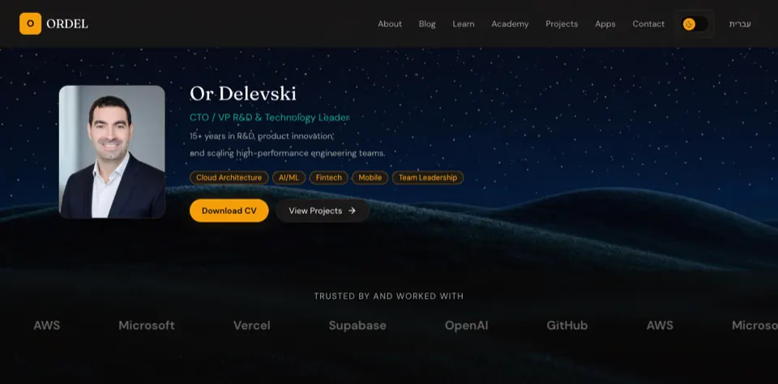
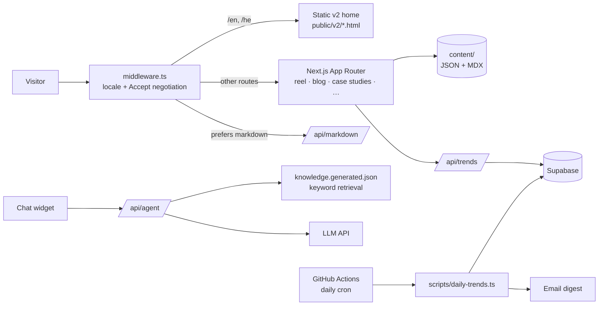

# ORDEL — Portfolio & Reel

**Or Delevski's bilingual (English / Hebrew) portfolio: a static, hand-built home page on top of a Next.js app with a scroll-driven video reel, case studies, a blog, a site chatbot grounded in the site's own content, and a daily AI-trends pipeline.**

**Live:** https://ordelwebsite.vercel.app ([English](https://ordelwebsite.vercel.app/en) · [עברית](https://ordelwebsite.vercel.app/he))



## What it does

- **Home page (v2)**: hero, selected-work carousel, projects, experience and CV, in English and Hebrew (RTL).
- **Reel** (`/reel`): a scroll-driven promotional video reel with captions and a music control.
- **Case studies, blog and learn guides** written in MDX, plus projects, apps, AI trends and contact pages.
- **Site chatbot**: answers visitors' questions using only what the site itself publishes.
- **Daily AI trends**: a scheduled job collects GitHub and Hugging Face trends, summarizes them, stores them, emails a Hebrew digest and can publish a blog post; the site reads them from `/api/trends`.
- **Agent-ready**: requests that prefer Markdown (`Accept` header) get a Markdown version of the page, and `llms.txt` describes the site for AI agents.

## Architecture



Key design decisions:

- **Static home, dynamic everything else.** The `/en` and `/he` home pages are hand-written static HTML/CSS/JS (`public/v2/`) served through Next.js rewrites, for full control over motion and load time; every other route stays in the Next.js app.
- **File-based content.** Projects, apps, courses, profile and testimonials are JSON in `content/`; posts and case studies are MDX. No CMS.
- **Grounded chatbot without a vector DB.** `scripts/build-knowledge.mjs` runs before every build and turns the site's own pages and content into text chunks; `/api/agent` retrieves by keyword scoring at request time and calls the model with only those chunks. Visitor messages are not logged or stored, and requests are rate-limited per hashed IP.
- **Bilingual by route.** `/en` and `/he` with an RTL layout for Hebrew; `/` redirects to the preferred locale (cookie or default).
- **Content negotiation for agents.** The middleware serves Markdown when the `Accept` header prefers it, and responses send `Vary: Accept`.
- **Automation on free infrastructure.** The trends pipeline runs on a GitHub Actions cron, with Supabase for storage and Resend for email.
- **Security headers** (`nosniff`, `X-Frame-Options: DENY`, strict referrer policy) in `vercel.json`, and long-lived caching for reel assets.

## Tech stack

- **Next.js 16** (App Router), **React 19**, **TypeScript**
- **Tailwind CSS 4**, Framer Motion, lucide-react
- **MDX** (next-mdx-remote, gray-matter, remark-gfm)
- **Supabase** (trends storage), **Resend** (email)
- **Vercel** hosting, Analytics and Speed Insights; Microsoft Clarity
- **GitHub Actions** (daily trends cron)
- Tests with `tsx --test` (chatbot, agent readiness)

## Project structure

```
app/[locale]/   reel, blog, learn, case-studies, projects, apps, ai-trends, about, contact, privacy
app/api/        agent (chatbot), markdown, trends
public/v2/      static EN/HE home pages, carousel, assets
content/        JSON content + MDX posts and case studies
lib/            i18n, content loaders, agent retrieval, reel
scripts/        build-knowledge, daily-trends, reel packs
supabase/       schema.sql
docs/           architecture, decisions, roadmap
```

## Run locally

```bash
npm install
npm run dev                 # http://localhost:3000/en and /he
npm run build && npm run start
```

Other scripts: `npm run lint`, `npm run knowledge` (rebuild chatbot knowledge), `npm run test:chat`, `npm run test:agent-readiness`, `npm run trends:daily`.

Environment variable names (set in Vercel / GitHub secrets, never committed): `NEXT_PUBLIC_SITE_URL`, `ANTHROPIC_API_KEY` and optional `ANTHROPIC_MODEL` for the chatbot; `SUPABASE_URL`, `SUPABASE_SERVICE_ROLE_KEY`, `MISTRAL_API_KEY`, `RESEND_API_KEY` for the trends pipeline.

More detail in [`docs/architecture.md`](docs/architecture.md) and [`docs/decisions.md`](docs/decisions.md).

## Status

Live on Vercel and actively updated; `main` deploys automatically.

## Author

**Or Delevski** · https://ordelwebsite.vercel.app
