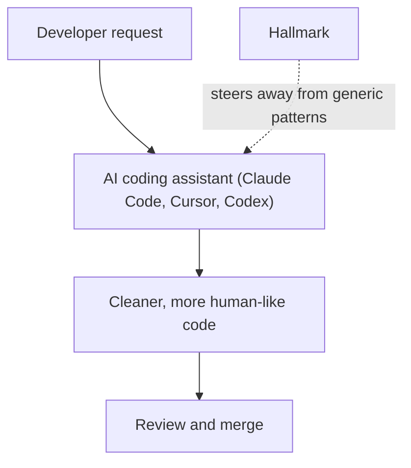

On 15 July 2026 Nutlope/hallmark was one of the AI repositories trending on GitHub, with 6,698 stars. Its one-line description is simple: it helps developers write cleaner, more human-like code by avoiding the generic patterns AI coding tools tend to produce — in tools like Claude Code, Cursor, and Codex.

## Why it matters

Anyone who has used an AI coding assistant knows the feeling: the code works, but it reads like it was written by a committee. Generic naming, boilerplate comments and over-defensive structure make a codebase harder to review and maintain. A tool aimed at that specific problem touches a real cost of AI-assisted development — review time.

It also matters because it is tool-agnostic by description: it targets the assistants developers already use (Claude Code, Cursor, Codex) instead of asking them to switch.

## How it works

The daily digest records the project's summary and numbers, not its internals, so this section sticks to what is known: Hallmark sits between you and your AI coding assistant, steering the assistant away from generic output. The diagram below is a simplified picture of that position in the workflow, drawn from the one-line description. The README is the source of truth for how it actually works.

## By the numbers

- **Stars on GitHub:** 6,698 on 15 July 2026 (from that day's GitHub Trending digest).
- **Source:** GitHub Trending, daily.
- The full list of that day's picks is in the comparison table at the end of this post.

## How to try it

The digest does not record install steps, so start from the project page:

1. Open the [repository](https://github.com/Nutlope/hallmark) and read the README.
2. Check which of your assistants it supports (the summary names Claude Code, Cursor and Codex).
3. Try it on one small, real task and compare the diff with and without it.

## Who it's for (and limits)

Hallmark is aimed at developers who already work with AI coding assistants and care about how the generated code reads. As with any young project, check the licence, the activity of the repository and how often it is updated before relying on it in a team setting.

## Links

- [Nutlope/hallmark on GitHub](https://github.com/Nutlope/hallmark)
- [All AI trends](/en/ai-trends)
