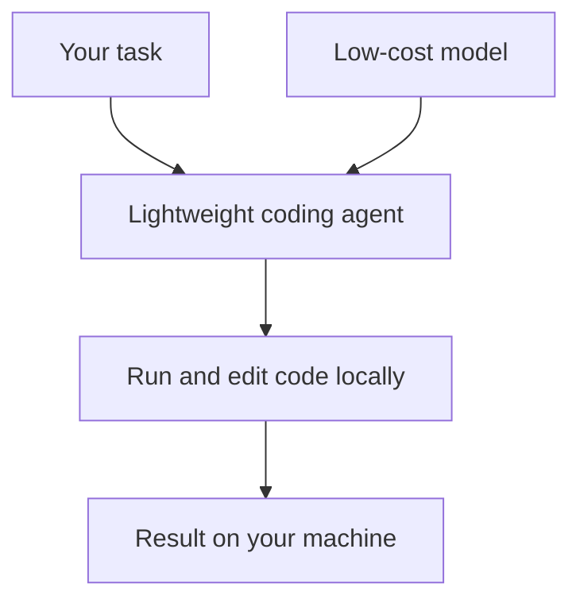

On 15 July 2026 openinterpreter/openinterpreter was trending on GitHub with 65,134 stars. It is described as a lightweight AI coding agent that lets low-cost models run and edit code locally on your own machine — making advanced AI tooling more accessible without relying on cloud APIs.

## Why it matters

Most capable coding agents are tied to a paid cloud model. A lightweight agent that works with inexpensive models and runs code locally changes the economics: you keep the code and the execution on your own machine, and the cost of experimenting drops.

That combination — local execution and low-cost models — is also why it is worth understanding even if you do not adopt it: it shows where agent tooling is heading.

## How it works

The digest records the project's summary and numbers, not its internals, so this section sticks to what is known. The diagram is a simplified picture of the flow described in the one-line summary: a task goes to an agent backed by a low-cost model, and the agent runs and edits code on your machine. The README is the source of truth for the real architecture.

## By the numbers

- **Stars on GitHub:** 65,134 on 15 July 2026 (from that day's GitHub Trending digest).
- **Source:** GitHub Trending, daily.
- The full list of that day's picks is in the comparison table at the end of this post.

## How to try it

The digest does not record install steps, so start from the project page:

1. Open the [repository](https://github.com/openinterpreter/openinterpreter) and read the README.
2. Note which models it supports and how it asks permission before running code.
3. Try it in a throw-away folder first — an agent that executes code locally deserves a sandbox.

## Who it's for (and limits)

Open Interpreter is aimed at developers who want an agent that runs on their own machine and works with inexpensive models. Because it executes code locally, read how it handles permissions and review what it runs before using it on anything important.

## Links

- [openinterpreter/openinterpreter on GitHub](https://github.com/openinterpreter/openinterpreter)
- [All AI trends](/en/ai-trends)
