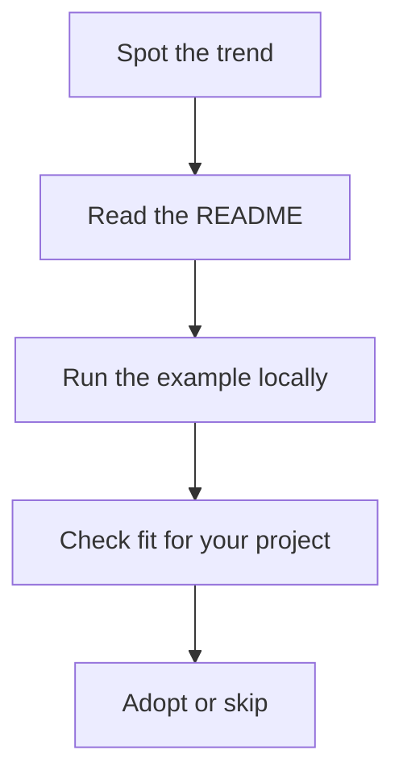

## Why it matters

An open source design system that's fully customizable and agent ready

This is one of today's most watched AI trends on GitHub. It is worth following if you build with modern models, agents, or open-source tooling.

## How to try it

Start from the project page and its README: [meta/astryx](https://github.com/meta/astryx).

## Links

- [meta/astryx](https://github.com/meta/astryx)

