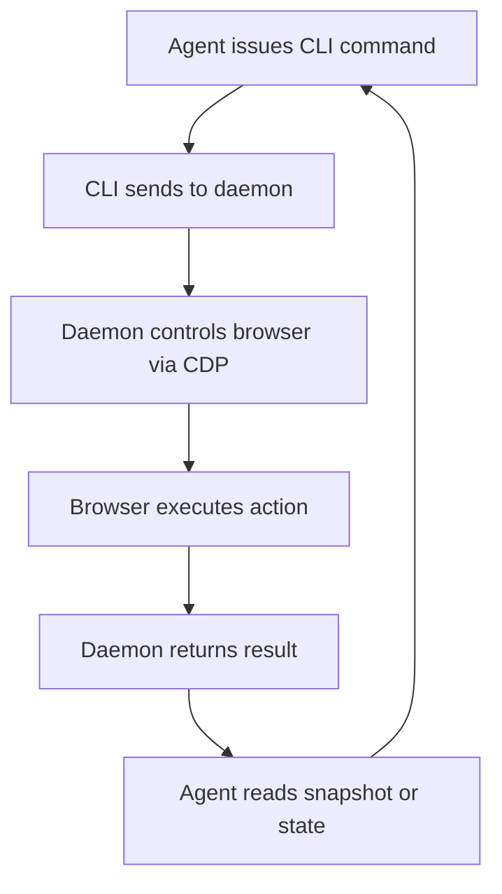

AI agents need to interact with web applications the way humans do: opening pages, reading content, clicking buttons, filling forms. Most existing automation tools are designed for scripting or testing, not for agents that reason about what they see and decide what to do next. agent-browser, from Vercel Labs, approaches this differently. It's a command-line tool written in Rust that treats browser automation as a conversation: the agent takes a snapshot of the page, receives a compact text representation with element references, acts on those references, and repeats.

The tool has gained significant traction—nearly 50,000 stars on GitHub—because it solves a real problem in the emerging agent infrastructure space. Rather than exposing raw DOM or screenshot pixels, it gives agents a structured, semantic view of the page that's both machine-readable and efficient.

## Why it matters

Building autonomous agents that can handle real-world web tasks requires more than just a browser driver. It requires a protocol that lets an AI system understand what's on the page, identify actionable elements, and receive feedback about the results of its actions—all in a way that's economical in terms of tokens and API calls.

Most browser automation tools (Selenium, Puppeteer, Playwright) were built for deterministic scripts or test suites. They return raw HTML, screenshots, or low-level events. An AI agent using these tools either needs to parse HTML and reason about layout, or analyze pixel-level screenshots—both expensive and error-prone.

agent-browser inverts this: it returns the page as a compact accessibility tree with semantic references. Each interactive element gets a ref like `@e1`. The agent reads that snapshot, decides what to do, issues a single command like `agent-browser click @e1`, and the tool reports success or failure. The browser stays open between commands, so each step is one short shell call. This design makes it practical for agents to automate complex workflows—form filling, multi-step navigation, conditional logic—without the overhead of full-page re-renders or screenshot analysis.

The tool also ships with skills—structured instructions that agents can load to understand how to use it. This bridges the gap between a CLI tool and an agent framework: the agent doesn't need hardcoded knowledge of the commands; it can ask the tool to teach it.

## How it works

### Architecture and command flow

agent-browser runs as a native Rust CLI that communicates with a background daemon. The daemon starts on the first command and controls the browser over the Chrome DevTools Protocol (CDP). Each session gets its own daemon and browser instance. By default, a headless browser closes and the daemon exits after one hour of inactivity, though session persistence can be configured to save state.



### Snapshots and references

The core interaction pattern revolves around snapshots. When an agent calls `agent-browser snapshot`, the tool returns the page as compact text. Interactive elements—links, buttons, inputs—are labeled with refs. For example, a link might appear as:

```
- link "Learn more" [ref=e1]
```

The agent can then act on that ref: `agent-browser click @e1`. Refs are valid only for the snapshot they came from; if the page changes (navigation, DOM update), a new snapshot must be taken before refs are reused.

The tool also supports CSS selectors, XPath, text matching, and semantic locators (e.g., `agent-browser find role button click --name "Submit"`), so agents have flexibility in how they target elements.

### Browser engines and providers

By default, agent-browser uses Chrome for Testing. But it's not locked to one browser. The tool can attach to a running Chrome instance via CDP mode, switch to alternative engines like Lightpanda or Obscura, drive Mobile Safari in the iOS Simulator, or connect to cloud browser providers—Browserbase, Browserless, Browser Use, Kernel, or AgentCore. This flexibility means agents can adapt to different environments and requirements.

### Failure handling

The tool is strict about success. If a click target is hidden, disabled, outside the viewport, or covered by another element (like a consent banner), the action fails rather than silently succeeding. This forces agents to handle real-world friction: dismiss the covering element, take a new snapshot, and retry. It's a design choice that mirrors how humans interact with the web.

## How to try it

Install via npm:

```bash
npm install -g agent-browser
agent-browser install           # download Chrome for Testing (first time only)
```

Homebrew is also available:

```bash
brew install agent-browser
agent-browser install
```

On Linux, use `agent-browser install --with-deps` to also install the browser's system libraries.

Once installed, open a page and interact:

```bash
agent-browser open example.com
agent-browser snapshot -i       # interactive elements, each with a ref
agent-browser click @e1         # act on a ref from that snapshot
agent-browser get url           # check the result
agent-browser close
```

For AI agents, the tool ships skills that can be loaded:

```bash
agent-browser skills get core                 # core loop, refs, waiting, workflows
agent-browser skills list                     # specialized skills: electron, slack, etc.
```

Agents can also use the MCP (Model Context Protocol) server:

```bash
agent-browser mcp                             # starts MCP server over stdio
```

For more detailed setup and configuration, see the [Installation](https://agent-browser.dev/installation) and [Quick Start](https://agent-browser.dev/quick-start) sections in the documentation.

## Who it's for (and limits)

agent-browser is designed for developers building AI agents that need to automate web tasks. It's particularly useful for:

- Agents that need to fill forms, navigate multi-step workflows, or interact with web applications
- Teams building agent infrastructure and want a standard, well-designed browser automation layer
- Use cases where token efficiency matters—snapshots are compact compared to full HTML or screenshots

The tool is not a replacement for traditional test automation (Playwright, Cypress) or web scraping libraries. It's optimized for the agent use case: interactive, reasoning-based control of a browser.

One important constraint: refs are snapshot-specific. If the DOM changes between snapshot and action, refs become invalid. Agents must be prepared to take new snapshots and retry. This is by design—it forces agents to reason about page state changes—but it does mean the interaction loop is not fire-and-forget.

The tool runs on macOS (ARM64, x64), Linux (ARM64, x64, glibc and musl), and Windows (x64), with native binaries distributed via npm.

## Links

- **Repository:** https://github.com/vercel-labs/agent-browser
- **Documentation:** https://agent-browser.dev
- **Commands reference:** https://agent-browser.dev/commands
- **Configuration:** https://agent-browser.dev/configuration

