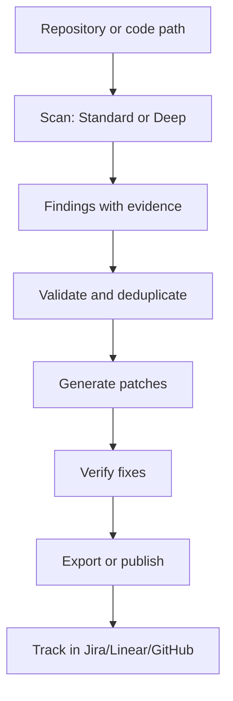

Security vulnerabilities in code are expensive to find and fix late in development. Codex Security addresses this by automating the discovery, investigation, and remediation of security issues as part of your normal workflow. Rather than treating security scanning as a separate gate, it integrates directly into your editor, terminal, and CI pipeline.

## Why it matters

Manual security code reviews don't scale. Static analysis tools generate noise. Penetration testing happens too late. The result is that many vulnerabilities slip through to production, discovered only after deployment or during incident response.

Codex Security shifts this timeline by automating the entire vulnerability lifecycle: finding issues, validating that they're real (not false positives), generating patches, and verifying fixes. Because it uses AI reasoning rather than pattern matching alone, it can understand context—authentication flows, data sensitivity, threat models specific to your application—rather than flagging every use of a deprecated function.

The tool also integrates with your existing security infrastructure. You can track findings in Linear, Jira, or GitHub; export results to SARIF for CI systems; or publish to Codex Security Cloud for team visibility. This means security findings become actionable work items, not reports that sit unread.

## How it works

Codex Security operates across three interfaces: within Codex (the AI editor), via command-line CLI, and through a TypeScript SDK for automation.

### Scanning and investigation

The core workflow starts with a scan. You can scan your entire repository, specific paths, or just the changes you've made since a base revision (useful for pull requests). The tool offers two scan modes:

- **Standard scans** investigate your code for vulnerabilities within a configurable time budget (default or custom, e.g., 15 minutes).
- **Deep scans** repeat the Standard investigation and return deduplicated findings, trading time for thoroughness.

Once a scan completes, it generates a report with source evidence and coverage notes—what was checked and what was excluded.

### Validation and patching

Finding a potential vulnerability is only the first step. Codex Security validates candidate findings to reduce false positives, then generates patches for confirmed issues. You can also ask it to verify that an existing fix actually resolves the vulnerability.

### Policy and threat modeling

The tool can draft or update a `SECURITY.md` policy file for your repository, incorporating your architecture and threat model. Scans use this guidance to focus on the risks that matter to your application. Threat models are saved with scan results and can be exported separately for later review.

### Integration and tracking

Findings can be published to third-party systems: Linear, Jira, GitHub Issues, or Codex Security Cloud. Reports can be exported as SARIF (for CI systems), JSON, or CSV. The tool also supports importing findings from other security scanners and deduplicating them against its own results.



### Authentication and cloud integration

For CLI and SDK use, you authenticate via `cs login` (interactive) or by setting `OPENAI_API_KEY` or `CODEX_API_KEY` in your environment. For headless machines (CI runners, containers), device or SSH login is available.

Codex Security Cloud is optional. Local scans work entirely offline; Cloud connection is only needed if you want to read or share findings across your team.

## How to try it

### CLI quick start

Codex Security requires Node.js 22.13.0+ (within 22.x) or Node.js 24.x or 26.x, plus Python 3.10+. Python 3.10 also requires `tomli`.

```bash
npm install --global @openai/codex-security
cs login
cs scan .
```

When the scan completes, open the Markdown report file shown in the terminal. To find a previous scan:

```bash
cs scans show
```

### Scan options

```bash
# Scan specific paths
cs scan . --path src --path tests

# Scan only changes since a base branch
cs scan . --diff origin/main

# Run a deep scan
cs scan . --mode deep

# Set a time budget (advisory, in minutes)
cs scan . --max-time 15
```

Use `cs --help` or `cs scan --help` for the full command reference.

### TypeScript SDK

For automation in your own code:

```bash
npm install @openai/codex-security
```

```ts
import { CodexSecurity } from "@openai/codex-security";

const security = new CodexSecurity();

try {
  const result = await security.run("/path/to/repository");
  console.log(result.reportPath);
} finally {
  await security.close();
}
```

See the SDK guide in the repository for deep-scan configuration, severity classification, and result handling.

### GitHub Actions

Add your OpenAI API key as a repository secret (`CODEX_SECURITY_API_KEY`), then copy the weekly workflow example from the repository to `.github/workflows/codex-security.yml`. The example runs a weekly scan with a $5 cost limit and reports findings without failing the job.

### Generate a security policy

```bash
cs policy .
cs policy . --path services/api --knowledge-base architecture.md
```

The tool drafts a policy outside your repository. Review it, edit if needed, then copy only the `SECURITY.md` file to your repository.

## Who it's for (and limits)

Codex Security is designed for teams that want automated, AI-assisted security scanning integrated into their development process. It works well for:

- **Development teams** using the CLI or SDK to scan before pushing code.
- **CI/CD pipelines** running scans on pull requests or scheduled intervals via GitHub Actions.
- **Security teams** using Codex Security Cloud to track findings across multiple repositories.
- **Organizations** that need to export findings to existing tools (Jira, Linear, SARIF-compatible systems).

### Important constraints

- **API key required**: Scans use OpenAI's API and incur costs. The tool supports cost limits and time budgets to control spending.
- **Supported model providers**: The tool works with OpenAI, Amazon Bedrock, and OpenRouter. Check the README for current provider support.
- **Cyber access**: Some cybersecurity requests and protected findings require Trusted Access for Cyber. Accounts with Daybreak access can opt in via CLI flags.
- **Node.js and Python versions**: Specific version requirements apply; check the README for exact details.
- **Scan coverage**: Scans report what was checked and what was excluded; coverage depends on repository size, scan mode, and time budget.

For details on scan history, linked Git worktrees, containerized bulk scans, and integration with third-party scanners, see the CLI and SDK documentation in the repository.

## Links

- **Repository**: https://github.com/openai/codex-security
- **CLI and SDK documentation**: See `sdk/typescript/docs/` in the repository
- **GitHub Actions guide**: See `github-action/README.md` in the repository
- **Scanner imports and integrations**: See `docs/scanner-imports/README.md` and `docs/plugin-connectors.md` in the repository

