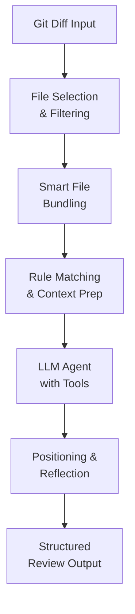

Code review at scale is hard. General-purpose AI agents excel at reasoning but struggle with precision, consistency, and the mechanical accuracy that code review demands. Alibaba's internal code review system, refined over two years and now released as Open Code Review, takes a different approach: it pairs deterministic engineering with LLM agents, letting each handle what it does best.

The tool reads Git diffs, sends changed files to a configurable LLM, and generates structured review comments with line-level precision. It can inspect full file contents, search the codebase for context, and review entire files for auditing unfamiliar code — not just surface-level diff feedback. The system has identified millions of code defects across tens of thousands of developers at Alibaba, and the company has now open-sourced it for the broader community.

## Why it matters

General-purpose agents like Claude Code with Skills have proven useful for many tasks, but they show consistent weaknesses in code review:

- **Incomplete coverage** — On larger changesets, agents selectively review only some files, missing important changes.
- **Position drift** — Reported issues frequently don't match actual code locations; line numbers and file references drift off target.
- **Unstable quality** — Natural-language-driven rule guidance is hard to debug, and review quality fluctuates with minor prompt changes.

These failures happen because purely language-driven architectures lack hard constraints. An issue reported on the wrong line wastes developer time. A missed security vulnerability in a large changeset defeats the purpose of automated review.

Open Code Review addresses this by separating concerns: deterministic logic handles what must not go wrong, while the agent handles dynamic decisions. The benchmark data supports this trade-off. Compared to general-purpose agents using the same underlying model, Open Code Review achieves significantly higher precision and F1 score while consuming only ~1/9 of the tokens and completing reviews faster. The trade-off is lower recall — a deliberate choice favoring fewer false alarms over maximum defect detection.

The benchmark itself is substantial: 50 popular open-source repositories, 200 real pull requests, 10 programming languages, and 1,505 annotated ground-truth issues cross-validated by 80+ senior engineers.

## How it works

The architecture combines two complementary strategies:

### Deterministic Engineering — Hard Constraints

Certain review steps must not fail, so they are governed by engineering logic rather than language model output:

- **Precise file selection** — Determines exactly which files need review and which should be filtered, ensuring no important change is missed.
- **Smart file bundling** — Groups related files into a single review unit (for example, `message_en.properties` and `message_zh.properties` are bundled together). Each bundle runs as a sub-agent with isolated context, enabling stable performance on very large changesets and supporting concurrent review.
- **Fine-grained rule matching** — Matches review rules to each file's characteristics using template-engine logic, keeping the model's attention focused and eliminating information noise at the source. This is more stable and predictable than purely language-driven rule guidance.
- **External positioning and reflection modules** — Independent modules systematically improve both the location accuracy and content accuracy of AI feedback.

### Agent — Dynamic Decision-Making

The LLM agent concentrates its strengths where they matter most:

- **Scenario-tuned prompts** — Prompt templates deeply optimized for code review, improving effectiveness while reducing token consumption.
- **Scenario-tuned toolset** — Derived from analysis of tool-call traces in large-scale production data, including call frequency distributions and per-tool repetition rates. The result is a purpose-built toolset more stable and predictable for code review than a generic agent toolkit.



The system can identify security issues like SQL injection and XSS, and it works with OpenAI and Anthropic models. The tool is written in Go and available as a CLI.

## How to try it

### Install

Open Code Review is available via npm:

```bash
npm install -g @alibaba-group/open-code-review
```

After installation, the `ocr` command is available globally. For other installation methods (install script, GitHub Release binary, from source), check the README.

### Configure and Review

Before reviewing code, configure an LLM endpoint:

```bash
ocr config provider          # Select a built-in provider or add a custom one
ocr config model             # Pick a model for the active provider
```

Then review code in several modes:

```bash
cd your-project

# Review all staged, unstaged, and untracked changes
ocr review

# Review changes in a branch since it diverged from main
ocr review --from main --to feature-branch

# Review a single commit
ocr review --commit abc123

# Full-file scan (review entire files, not just diffs)
ocr scan
ocr scan --path internal/agent

# Save results to a file
ocr review --format json --output result.json
```

You can also resume interrupted reviews:

```bash
ocr session list
ocr review --from main --to feature-branch --resume <session-id>
```

For full configuration details, environment variables, custom providers, and delegation mode (where an AI host agent performs the review), see the README.

## Who it's for (and limits)

Open Code Review is designed for teams that want deterministic, precise code review without the false-alarm overhead of general-purpose agents. It works across multiple programming languages and integrates into CI pipelines.

The tool requires Git >= 2.41 for diff generation, code search, and repository operations.

The precision-over-recall trade-off means some defects may be missed in favor of reducing noise. This is intentional — the assumption is that developers prefer fewer false alarms to catch-everything-at-any-cost. Teams with different risk profiles should evaluate the benchmark data and consider their own tolerance for missed issues.

The system is production-tested at scale, but as with any AI-powered tool, results depend on model quality and configuration. Check the README for advanced setup and troubleshooting.

## Links

- **Repository:** https://github.com/alibaba/open-code-review
- **Official website:** https://open-codereview.ai
- **Benchmark dataset:** Available on Hugging Face (AACR-Bench)
- **Installation & configuration:** See the README for detailed setup steps, environment variables, and custom provider configuration

