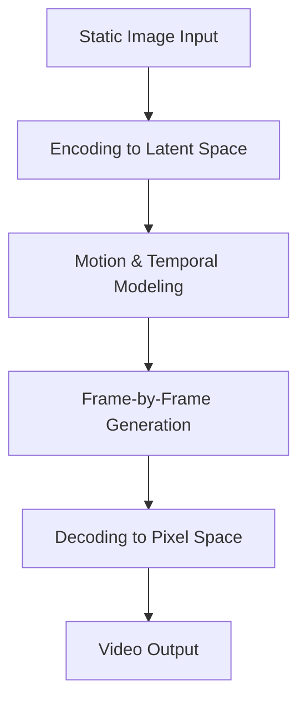

Image-to-video generation—the task of creating dynamic video sequences from a single static image—remains one of the more demanding challenges in generative AI. It requires a model to not only understand spatial composition but to synthesize plausible motion, lighting changes, and temporal coherence across frames. Lightricks' LTX-2.5 has emerged as a notable entry in this space, accumulating significant community adoption and engagement metrics that suggest practical utility.

## Why it matters

Video generation from images addresses a real workflow gap. Content creators, designers, and developers often work with static assets—product photos, concept art, architectural renderings—and need to explore how those subjects might move or change over time. Rather than shooting new footage or manually animating frames, an image-to-video model can generate candidate sequences in seconds.

The adoption numbers tell part of the story. With 2.7 million downloads and over 11,000 likes on Hugging Face, LTX-2.5 has become the most downloaded trending model in its category. This level of engagement suggests the model addresses a genuine need and performs well enough that users return to it and recommend it to others. High download counts in the generative AI space often correlate with a combination of capability, ease of use, and reliability—though they do not guarantee any single metric of quality.

## How it works

The specifics of LTX-2.5's architecture and training approach are not detailed in the available summary material. To understand the technical implementation—such as the underlying neural network structure, training data, loss functions, or inference optimizations—you should consult the full README on the model card.

What can be said generally about image-to-video models is that they typically operate in stages:

The flow above represents a common pattern: an input image is encoded into a compressed representation, a temporal model predicts how that representation should evolve frame-by-frame, and a decoder reconstructs pixel-space video from those predictions. LTX-2.5 may follow this general pattern or employ a different architecture; the README will clarify the specifics.

## How to try it

LTX-2.5 is hosted on Hugging Face and can be accessed via the model card at https://huggingface.co/Lightricks/LTX-2.5. The README on that page will contain the most current instructions for running the model, including:

- System requirements and dependencies
- Installation steps
- Code examples showing how to load the model and generate video from an image
- Parameter options for controlling output quality, length, or style

For exact usage code and setup procedures, refer directly to the README rather than relying on general guidance, as model interfaces and requirements can change.

## Who it's for (and limits)

LTX-2.5 is likely useful for:

- **Content creators** exploring motion for marketing or social media
- **Designers and artists** wanting to preview static concepts in motion
- **Developers** building applications that need video generation capabilities
- **Researchers** studying generative video models

The model's popularity suggests it works well for these use cases, but any image-to-video system has inherent limitations worth understanding:

- **Motion realism**: Generated motion may not always match real-world physics or natural movement, especially for complex interactions.
- **Temporal consistency**: Artifacts or flickering can occur across frames, particularly in longer sequences.
- **Semantic understanding**: The model may struggle with abstract concepts or unusual compositions that were underrepresented in training data.
- **Computational cost**: Video generation is computationally expensive; inference time and memory requirements should be verified against your hardware.
- **Output length and resolution**: There are typically constraints on how long a video can be and at what resolution it can be generated.

The exact capabilities and limitations of LTX-2.5 are best understood by reviewing the model card and, ideally, testing it on representative inputs relevant to your use case.

## Links

- **Model**: https://huggingface.co/Lightricks/LTX-2.5
- **README & Documentation**: Available on the model card page (check the README tab for setup, usage examples, and technical details)

