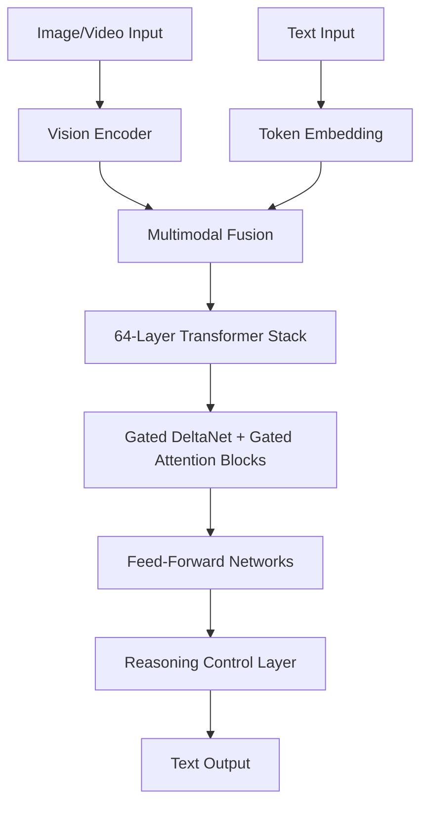

Qwen3.8-27B represents the latest iteration in Alibaba's open-source language model family, building on the architectural foundation of Qwen3.5 while introducing substantial improvements across coding, professional work, research, and agentic task execution. As a multimodal model, it handles both text and images natively, and the model card indicates it can process videos as well. With 6.5 million downloads and over 20,000 likes on Hugging Face, it has achieved significant adoption in the open-source AI community.

The model is distributed in Hugging Face Transformers format and is compatible with popular inference frameworks including vLLM, SGLang, and TokenSpeed, making it accessible for both research and production deployment scenarios.

## Why it matters

The release of Qwen3.8-27B addresses a specific gap in the open-source model landscape: a compact, deployable dense model that combines vision-language understanding with reasoning capabilities suitable for autonomous agents and multi-step workflows. At 27 billion parameters, it sits in a practical range for organizations seeking to run models on consumer-grade or modest enterprise hardware without sacrificing capability.

The model's native support for images and videos is particularly relevant for real-world applications. The model card mentions it can handle "STEM diagrams and documents" as well as "hour-scale videos," suggesting it was designed with practical use cases in mind beyond simple image captioning.

The introduction of flexible thinking control—where reasoning mode is on by default but can be disabled per request, with tunable `reasoning_effort` parameters—indicates a deliberate design choice to balance inference cost with reasoning depth. This flexibility allows users to trade off latency and compute for accuracy on a per-request basis rather than committing to a fixed reasoning budget at deployment time.

## How it works

### Architecture and scale

Qwen3.8-27B is a causal language model with an integrated vision encoder. The language model component contains 27 billion parameters organized across 64 layers. The hidden dimension is 5,120, and the token embedding dimension is 248,320 (padded). The model uses a hybrid attention mechanism:

- **Gated DeltaNet layers** (linear attention variant) with 48 linear attention heads for values and 16 for query-key, each with 128-dimensional heads
- **Gated Attention layers** with 24 query heads and 4 key-value heads, each with 256-dimensional heads and 64-dimensional rotary position embeddings
- **Feed-forward networks** with an intermediate dimension of 17,408

The layer structure follows a repeating pattern: 16 blocks of (3 × (Gated DeltaNet → FFN) → 1 × (Gated Attention → FFN)).

### Context and reasoning

The model supports a native context length of 262,144 tokens and is extensible to 1,000,000 tokens. It was trained with multi-token prediction (MTP) across multiple steps, a technique that can improve both efficiency and reasoning quality.

The thinking mechanism operates through three control parameters: thinking mode is enabled by default, `reasoning_effort` allows tuning of reasoning depth, and `preserve_thinking` retains reasoning context from historical messages in multi-turn conversations.

### Vision-language integration

The model includes a native vision encoder, enabling it to process images and video frames without external preprocessing. The model card does not provide architectural details of the vision encoder itself; consult the README for those specifics.

## How to try it

The model is available on Hugging Face in Transformers format. For specific installation and usage instructions, consult the README at the model repository. The model card indicates compatibility with Hugging Face Transformers, vLLM, SGLang, and TokenSpeed, so integration depends on your chosen inference framework.

For managed inference without infrastructure maintenance, Alibaba offers a hosted version through Qwen Cloud. According to the model card, the hosted Qwen3.8-27B service is "coming soon" and will include features such as 1M context length by default and official built-in tools. More information is available at the Qwen3.8-27B Overview on Qwen Cloud.

## Who it's for (and limits)

Qwen3.8-27B is well-suited for:

- **Agentic workflows**: The model card emphasizes "stronger autonomous planning and better handling of environment feedback" for end-to-end task completion.
- **Coding tasks**: Benchmark results show competitive performance on agentic terminal coding (Terminal Bench 2.1: 73.0), agentic coding (SWE-bench Pro: 61.7), and repo-level code generation (NL2Repo-Bench: 42.3).
- **Document and diagram understanding**: Native vision capabilities support STEM diagrams and professional documents.
- **Long-horizon reasoning**: The flexible thinking control and extended context window support complex, multi-step reasoning.
- **Organizations with deployment constraints**: At 27B parameters, it is more deployable than larger models while maintaining broad capability.

### Known constraints

The model card does not provide information on inference speed, memory requirements, or quantization support. It does not specify performance on vision-language benchmarks or video understanding tasks beyond the general claim of support. For detailed performance metrics and limitations, check the README.

The model is released under the Apache 2.0 license, permitting commercial use with attribution.

## Links

- **Model repository**: https://huggingface.co/Qwen/Qwen3.8-27B
- **Qwen Cloud hosted service**: https://www.qwencloud.com/models/qwen3.8-27b
- **README and model card**: Available at the Hugging Face repository

