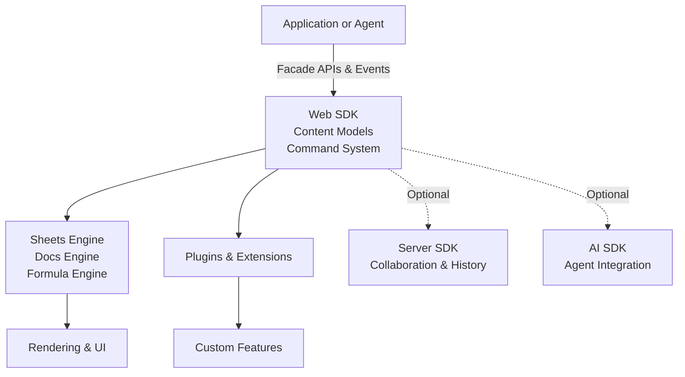

Univer is an Office SDK designed to let developers embed office-grade editing and collaboration directly into their own products. Rather than building from scratch or relying on external services, teams can compose Univer's modular components—spreadsheets, documents, formulas, real-time collaboration—into custom applications. The project has accumulated 27,461 GitHub stars and is written in TypeScript.

The core insight behind Univer is architectural: office software is complex, but its pieces—content models, rendering, calculation, undo/redo, permissions—can be separated and reused. The open-source foundation covers the Web SDK layer, while optional commercial extensions add server-side collaboration, file import/export, and AI agent integrations.

## Why it matters

Most products that need office capabilities face a choice: build from scratch (expensive, error-prone), embed a third-party service (loss of control, data residency concerns), or license desktop software (inflexible). Univer offers a fourth path: use an open-source, extensible foundation that you control and can modify.

The timing matters. As AI agents and workflows become more common, they need to interact with structured data—spreadsheets, documents, tables. Univer's architecture allows agents to use the same APIs as human users, reading and writing content through a consistent interface. The open-source core means you're not locked into a vendor's AI strategy; you can wire your own models and orchestration.

For teams building internal tools, customer-facing applications, or agent workflows, embedding office editing avoids the complexity of maintaining separate data formats and sync logic. Content stays in one place, and edits flow through a single command system.

## How it works

Univer is organized into three layers:

**Web SDK** (open-source, in this repository) provides the foundation: content models and snapshot formats, a plugin system with dependency injection, a command system for coordinated edits, formula and rendering engines, and Facade APIs (the public interface for applications). You can compose plugins into an embedded editor or use the content models and calculation in headless mode—Node.js scripts or backend services—without any UI.

**Server SDK** (commercial) adds backend services for real-time collaboration, edit history, and import/export of Office file formats.

**AI SDK** (commercial extensions available) connects office capabilities to agents and workflows, with content tools, execution, and review integrations.

The open-source capabilities include:

- **Sheets**: cell styles, merged cells, in-cell rich text, freeze panes, floating images, undo/redo, formulas, defined names, filtering, sorting, data validation, conditional formatting, hyperlinks, comments, and find/replace.
- **Docs**: rich-text editing, paragraph formatting, lists, hyperlinks, comments, and drawing integration.

A key architectural feature is **cross-feature undo/redo**. When you insert a row inside a filtered range, both the base content and the filter state change. Each feature supplies its own changes and undo data; the command system composes their execution and history. This means custom features can integrate cleanly without reimplementing undo logic.

The plugin system uses dependency injection, so features declare what they need and the runtime wires them together. This boundary-based design makes it easier to add custom features without tangling with existing code.

## How to try it

The README points to a quick start guide. For detailed setup instructions, check the [quick start section](https://github.com/dream-num/univer#quick-start) in the repository or the [documentation](https://docs.univer.ai/).

The project also provides:

- A [feature comparison](https://univer.ai/compare/) showing what's open-source versus commercial.
- Live [demos](https://univer.ai/demo/spreadsheets) of spreadsheets, documents, slides, relational tables, canvases, and PDFs.
- A [reference application](https://github.com/dream-num/univer-workspace) called Univer Workspace showing a complete Office SDK setup.
- A [headless guide](https://docs.univer.ai/guides/sheets/getting-started/node) for using Univer in Node.js without a UI.
- [API reference](https://docs.univer.ai/reference/classes/univer) and [blog](https://docs.univer.ai/blog) for deeper dives.

## Who it's for (and limits)

Univer is suited for:

- **Product teams** embedding office editing into SaaS applications, ERPs, or internal tools.
- **Agent developers** building workflows that need to read and write structured data.
- **Backend engineers** processing office files or running calculations in Node.js.
- **Teams needing data sovereignty** who want to avoid cloud-dependent services.

The open-source Web SDK is sufficient for many use cases—embedded editing, headless processing, and custom feature development. Real-time collaboration, file import/export, and AI agent integrations require commercial extensions, which are distributed separately.

The project is under Apache-2.0 license for the open-source core. Commercial plugins and SDKs have separate licensing; check the README or website for details.

One constraint: the open-source foundation covers Sheets and Docs. Slides, relational tables, canvases, and PDFs are shown in demos but may require commercial extensions or are in development. The [feature comparison](https://univer.ai/compare/) clarifies what's available in each tier.

## Links

- **Repository**: https://github.com/dream-num/univer
- **Documentation**: https://docs.univer.ai/
- **Website**: https://univer.ai/
- **Feature Comparison**: https://univer.ai/compare/
- **Workspace Reference App**: https://github.com/dream-num/univer-workspace
- **Community**: Discord, Twitter (@univerhq), and OpenCollective (links in README)

