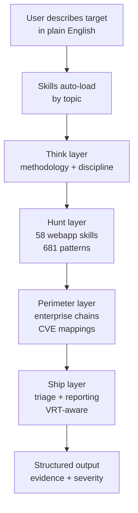

Claude-BugHunter is a skill bundle for Claude Code that transforms the model from a general-purpose assistant into a specialized bug-hunting and red-team operator. Built by Sachin Sharma, it bundles 83 skills, 15 slash commands, and 681 disclosed vulnerability patterns—433 of which are individually cited and auditable—organized across 24 core vulnerability classes. The bundle is designed to stay in scope, follow red-team discipline, and automate the detection, validation, and reporting workflows that characterize professional security testing.

## Why it matters

Bug bounty hunting and external red-team work require consistent methodology, deep knowledge of vulnerability patterns, and strict operational discipline. A researcher must know not just *what* to test, but *how* to test it without breaking scope, how to validate findings rigorously, and how to report them in formats that match each platform's vulnerability rating taxonomy (HackerOne, Bugcrowd, Intigriti, Immunefi).

Claude-BugHunter addresses this by encoding that knowledge directly into Claude's skill system. Rather than asking the model to generate payloads or methodology from first principles each time, the bundle provides curated, battle-tested patterns extracted from 681 disclosed HackerOne reports. It includes enterprise platform chains (M365, Okta, vCenter, SSL-VPN appliances, SharePoint) with current 2024–2026 CVE mappings, and it enforces the "7-Question Gate" for triage validation—a structured decision framework that reduces false positives and scope violations.

The bundle is also designed to work across multiple agent harnesses (Claude Code, OpenCode, OpenAI Codex CLI, Hermes Agent, Google AntiGravity), meaning the same skills can be deployed in different environments without rewriting.

## How it works

Claude-BugHunter organizes security testing into four stacked layers:

**Think** — The methodology and mindset layer. This includes the 5-phase non-linear workflow, a critical-thinking framework, and red-team operator discipline rules that keep testing in scope and prevent common mistakes.

**Hunt webapps** — 58 hunt-* skills derived from 681 disclosed reports. Each skill covers a specific vulnerability class (IDOR, SSRF, RCE chains, OAuth bypass, JWT attacks, file upload, etc.) and includes detection patterns, payloads, bypass tables, and chain templates.

**Hit the perimeter** — Enterprise platform chains for M365/Entra, Okta, vCenter, SSL-VPN appliances (Cisco, Fortinet, Citrix, Palo Alto, Pulse, SonicWall, F5), SharePoint, and cloud misconfig scenarios. These include current CVE chains and post-credential escalation paths.

**Ship it** — Triage validation, reporting, and evidence hygiene. This layer includes the 7-Question Gate for severity assessment, VRT-aware mappings for each bounty platform, out-of-scope rebuttals, PII redaction, and red-team deliverable formatting.

All skills load automatically based on the user's description of what they're testing—no need to invoke them by name. Describe "testing acme.com, an in-scope HackerOne target," and the bundle loads web2-recon, offensive-osint, and bb-methodology skills automatically.



The bundle integrates with Burp Suite via MCP (Model Context Protocol), allowing Claude to interact with proxy data and request/response history directly. It also includes an engagement scaffolder (`hunt` command) that sets up folder structure and templates for organized red-team work.

## How to try it

**Option A — install as a Claude Code plugin (recommended):**

```text
/plugin marketplace add elementalsouls/Claude-BugHunter
/plugin install claude-bughunter@elementalsouls
```

All 83 skills and 15 commands load namespaced under `claude-bughunter:` and update automatically when you bump the plugin version.

**Option B — copy install (for pinning to a specific version or using the `hunt` scaffolder):**

```bash
git clone https://github.com/elementalsouls/Claude-BugHunter.git
cd Claude-BugHunter

# macOS / Linux
bash scripts/install.sh

# Windows (PowerShell)
pwsh ./scripts/install.ps1
```

This copies skills into `~/.claude/` (macOS/Linux) or `%USERPROFILE%\.claude\` (Windows) and enables the `hunt` engagement scaffolder.

The plugin path is fastest for accessing the skills. The copy install is better if you want the CLI tool (`cbh`) or the engagement scaffolder. For multi-harness deployment (OpenCode, Hermes, Google AntiGravity, etc.), use `--all` flag:

```bash
bash scripts/install.sh --all --burp-mcp
```

See the [Installation guide](https://github.com/elementalsouls/Claude-BugHunter/blob/main/INSTALL.md) and [Usage guide](https://github.com/elementalsouls/Claude-BugHunter/blob/main/USAGE.md) in the repository for detailed steps.

## Who it's for (and limits)

**In scope:**

- Bug bounty hunters testing web apps, APIs, SaaS platforms, GraphQL, OAuth, and JWT implementations
- Penettesters conducting web application assessments
- External red-team operators targeting internet-facing enterprise infrastructure (M365, Okta, vCenter, SSL-VPN, SharePoint)
- Cloud misconfig and post-credential escalation testing
- OSINT and recon work (subdomain enumeration, identity-fabric mapping, certificate transparency, secret scanning)
- Reporting to HackerOne, Bugcrowd, Intigriti, Immunefi, and client-facing red-team deliverables

**Deliberately out of scope:**

- Internal Active Directory attacks (Kerberoasting, ASREProast, DCSync, BloodHound chains)
- C2 frameworks and post-exploit tradecraft (Cobalt Strike, Sliver, persistence, lateral movement)
- AMSI/ETW bypass and AV/EDR evasion
- iOS, hardware, RF, and ICS testing
- Binary exploitation and kernel pwn

The bundle is explicitly designed for the external attack surface. If your engagement includes internal domain takeover or lateral movement via Kerberos, you'll need separate tooling (Impacket, NetExec, CrackMapSec, Rubeus, Certify, BloodHound). The handoff between external and internal red-team phases is intentional—the bundle stays focused on what it does well.

## Links

- **Repository:** https://github.com/elementalsouls/Claude-BugHunter
- **Installation guide:** https://github.com/elementalsouls/Claude-BugHunter/blob/main/INSTALL.md
- **Usage guide:** https://github.com/elementalsouls/Claude-BugHunter/blob/main/USAGE.md
- **Skill catalog:** https://github.com/elementalsouls/Claude-BugHunter/blob/main/docs/skills.md

