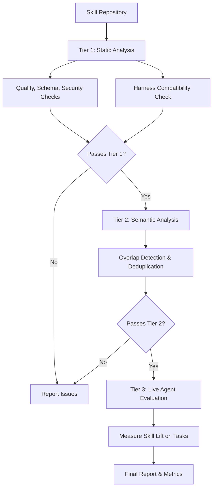

AI agents are becoming more capable, but their effectiveness depends heavily on the skills and plugins they can access. A poorly designed skill can degrade performance, introduce security risks, or duplicate functionality already present elsewhere. NVIDIA's SkillEvaluator addresses this problem by providing a structured framework to evaluate agent skills across multiple dimensions—from static quality checks to live agent testing—without requiring teams to build and maintain custom evaluation infrastructure.

The project, which has accumulated over 3,400 stars on GitHub, sits within NVIDIA's broader Verified Skills pipeline and implements the Agent Skills specification. It's designed to catch skill issues before merge, integrate directly into CI/CD workflows, and measure the actual impact of a skill on agent task completion.

## Why it matters

Agent skills are modular units of capability—folders containing instructions and supporting files that agents can load and use. As the number of available skills grows, so does the risk of shipping low-quality, insecure, or redundant code. Manual review doesn't scale.

SkillEvaluator solves this by automating the evaluation pipeline. It runs 11 different checks backed by over 500 static rules and detection patterns. These include quality scoring, schema validation, PII detection, license compliance, Unicode linting, and security scanning via SkillSpector, Gitleaks, Bandit, and optional Semgrep integration.

The framework goes beyond static analysis. It can detect skill overlap—identifying when a new skill duplicates functionality already available—and measure real behavioral impact by running agents with and without the skill to compare task outcomes. This "lift" measurement is critical: a skill that passes all quality gates but doesn't actually improve agent performance isn't worth shipping.

For teams managing skill repositories, SkillEvaluator eliminates the need to write and maintain evaluation code. Instead, they connect their repository via a CI template and define thresholds. The framework handles the rest.

## How it works

SkillEvaluator operates in three tiers, each adding depth to the evaluation:

**Tier 1** runs locally without API keys or external services. It performs static analysis: quality checks, schema validation, version checks, PII scanning, license detection, Unicode and script linting, and security scanning. The Harness Check component tests whether a skill will actually load in specific agent environments (Codex, Claude Code, OpenCode, Hermes, OpenClaw, Copilot CLI) by validating compatibility profiles and checking constraints like description length and UTF-16 encoding limits.

**Tier 2** adds deduplication and semantic analysis. It uses embeddings and chat models to detect overlapping skills and identify redundant functionality.

**Tier 3** runs live agent evaluation. The framework deploys the skill to a real agent, runs tasks with and without it, and measures the actual behavioral impact.



The quality check produces a score out of 100 with a grade; the default passing threshold is 70. The Harness Check output shows compatibility status for each agent profile—whether a skill loads, degrades, or fails to load, with specific diagnostic notes.

For CI integration, SkillEvaluator provides ready-to-use workflow templates for GitHub and GitLab. These templates run Tier 1 checks automatically on pull requests without requiring an API key. Optional workflows can add PR comments with results or publish hosted reports.

## How to try it

Install the CLI in a Python 3.12–3.14 environment:

```bash
pip install skillevaluator
```

Alternatively, using `uv`:

```bash
uv tool install --python 3.13 skillevaluator
```

Run a quality check on a skill folder without any API key:

```bash
skillevaluator quality-check ./my-skill
```

This produces a score and grade based on static analysis alone. No LLM key, scanner, GPU, or Docker is required.

To check harness compatibility:

```bash
skillevaluator harness-check ./my-skill
```

This validates whether the skill will load in different agent environments and reports specific compatibility issues.

To run all three tiers, you'll need an NVIDIA API key. Eligible NVIDIA Developer Program members can obtain a free key from [build.nvidia.com](https://build.nvidia.com/) for prototyping. After setup and installing the full package, run:

```bash
pip install "skillevaluator[all]"
export SKILL_EVAL_LLM_PROVIDER=nv_build
export NVIDIA_API_KEY='nvapi-...'
skillevaluator validate ./my-skill
```

To integrate SkillEvaluator into your repository's CI pipeline, run:

```bash
skillevaluator ci init
```

This guides you through setup and generates a PR with the appropriate workflow configuration for GitHub or GitLab. Alternatively, copy a pre-filled template from the repository's `ci/bundles/` directory.

For detailed installation options, configuration, and dataset preparation, see the official documentation linked below.

## Who it's for (and limits)

SkillEvaluator is designed for teams building and maintaining repositories of AI agent skills. It's particularly valuable for:

- **Skill authors** who want to validate their work before submission
- **Repository maintainers** who need to enforce quality and security standards at scale
- **CI/CD pipelines** that require automated evaluation without custom code

The framework is most useful when skills follow the Agent Skills specification. Teams using non-standard skill formats will need to adapt.

Tier 1 checks run entirely offline and are free. Tier 2 and Tier 3 require an LLM provider and associated API costs or rate limits. The free NVIDIA Build key is available only to eligible Developer Program members and is subject to access terms and rate limits.

Live agent evaluation (Tier 3) requires Docker to be running and a reviewed evaluation dataset. This adds operational complexity compared to static checks alone.

The tool is actively maintained and documented, with a reference skill included in the repository for testing.

## Links

- **Repository:** https://github.com/NVIDIA/SkillEvaluator
- **Documentation:** https://docs.nvidia.com/skills/skillevaluator/
- **PyPI Package:** https://pypi.org/project/skillevaluator/
- **Research Paper:** https://arxiv.org/abs/2608.20614
- **NVIDIA Blog:** https://developer.nvidia.com/blog/evaluating-ai-agent-skill-performance-with-nvidia-skillevaluator/

