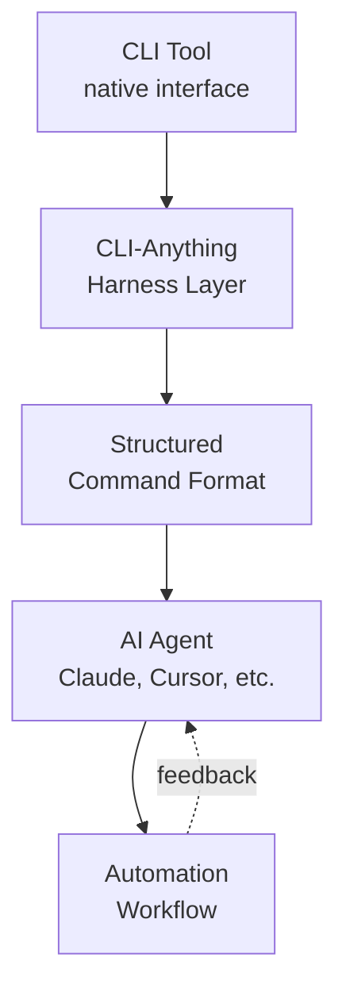

The gap between traditional command-line software and modern AI agents has been a practical friction point. Most CLI tools were designed for human operators typing commands; AI agents need structured, predictable interfaces. CLI-Anything addresses this by generating agent-compatible wrappers around existing command-line tools, making them directly usable by systems like Claude Code, Cursor, and other AI agents without requiring changes to the original software.

The project has accumulated over 60,000 GitHub stars, indicating substantial community interest in the problem it solves. The core insight is straightforward: rather than waiting for every software vendor to build agent-native APIs, create a framework that can adapt existing CLIs to work seamlessly with AI automation workflows.

## Why it matters

Software automation today faces a structural problem. Thousands of mature, specialized CLI tools exist—from video editors to GIS systems to music production software—but they were built for human interaction. When an AI agent needs to use these tools, it must either:

1. Parse unstructured text output and infer intent from human-readable help text
2. Wait for vendors to build agent APIs (which rarely happens for niche tools)
3. Simulate keyboard and mouse input (fragile and slow)

CLI-Anything sidesteps this by creating a standardized harness layer. Once a tool is wrapped, any AI agent framework can interact with it using consistent command structures and predictable output formats. This unlocks automation across a much wider range of software than would otherwise be practical.

The project also operates a registry system (CLI-Hub) where community members can contribute harnesses for new tools. This distributes the work of integration across many contributors rather than centralizing it.

## How it works

### Architecture and harness generation

CLI-Anything works by generating Python-based harnesses that wrap CLI tools. Each harness translates between the agent's structured requests and the tool's native command-line interface. The framework provides templates and utilities to make building these harnesses straightforward.

The harnesses handle several practical problems:
- Parsing and normalizing command output into structured formats
- Managing tool state and configuration
- Handling errors and edge cases specific to each tool
- Providing agents with accurate descriptions of available commands and parameters

### The CLI-Hub registry

CLI-Hub (`pip install cli-anything-hub`) is a package manager for these harnesses. Users can browse available CLIs, install them with `cli-hub install <name>`, and manage updates. The registry includes both CLI-Anything-built harnesses and public CLIs from various sources (pip, npm, brew, bundled tools).

According to the material, the registry supports multiple installation sources and includes metadata for discovery. The web interface at https://hkuds.github.io/CLI-Anything/ allows browsing available tools.

### Community contribution model

The project accepts contributions via pull requests. New harnesses go through review before merging into the public registry. Contributors can sign up through the GitHub issues template, and once merged, gain recognition as community contributors.



## How to try it

The README indicates installation via pip:

```bash
pip install cli-anything-hub
cli-hub install <name>
```

For specific tool usage and available commands, check the [CLI-Anything README](https://github.com/HKUDS/CLI-Anything) and the [CLI-Hub web interface](https://hkuds.github.io/CLI-Anything/), which lists all available harnesses and their documentation.

To request support for a specific tool, the project accepts wishlist requests via GitHub issues. To build a new harness, contributors can open a contributor signup issue and follow the contribution guidelines in the repository.

## Who it's for (and limits)

CLI-Anything is most useful for:

- **AI agent developers** building automation systems that need to control existing software
- **Organizations** with specialized CLI tools that need to integrate into agent workflows
- **Open-source communities** maintaining tools that want agent compatibility without building their own APIs

The framework works best with tools that have stable, text-based command-line interfaces. Tools with complex interactive modes, heavy GUI dependencies, or frequently changing output formats may be more difficult to wrap effectively.

The project's scope is specifically CLI tools. Software without command-line interfaces would require different approaches (GUI automation, API wrapping, etc.).

The material does not provide performance benchmarks, latency measurements, or comparisons with alternative integration approaches, so those details would need to be checked in the full documentation or through testing.

## Links

- **Repository**: https://github.com/HKUDS/CLI-Anything
- **CLI-Hub web interface**: https://hkuds.github.io/CLI-Anything/
- **CLI-Hub package**: `pip install cli-anything-hub`
- **Contributing guide**: See CONTRIBUTING.md in the repository
- **Research paper**: arxiv.org/abs/2606.03854 (referenced in README)

