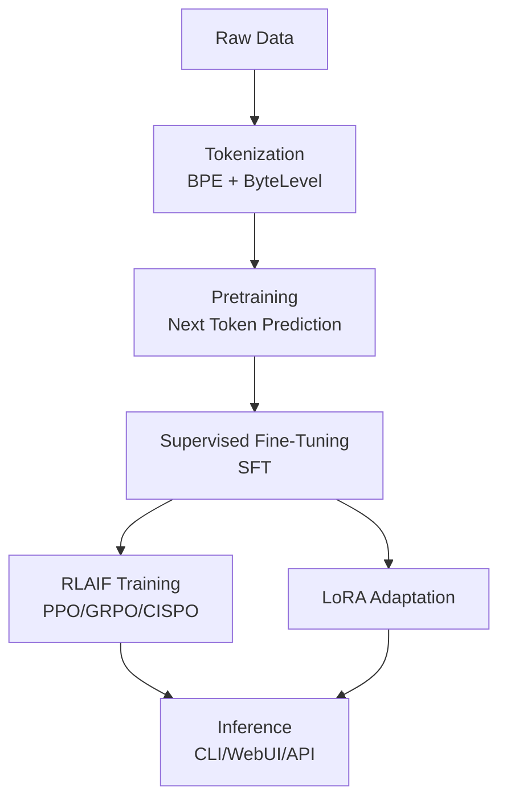

Most language model projects assume you have access to massive computational resources. MiniMind takes the opposite approach: it demonstrates that you can train a working language model from scratch on a single NVIDIA 3090 GPU in about 2 hours, spending roughly $3 on cloud compute. The project includes complete training code, data pipelines, and inference implementations—all written from first principles using PyTorch, without relying on high-level framework abstractions.

The core model is approximately 64 million parameters, making it roughly 1/2700th the size of GPT-3. Despite its small scale, MiniMind implements the full pipeline that larger models use: pretraining, supervised fine-tuning (SFT), reinforcement learning from AI feedback (RLAIF), tool use, and reasoning capabilities.

## Why it matters

Language model development has become gatekept by computational scale. Most tutorials focus on fine-tuning existing models with LoRA, which teaches you how to use a tool but not how it works internally. MiniMind inverts this: it's designed as an educational project where every line of core algorithm code is implemented from scratch, making the internals visible and understandable.

The project targets two audiences: developers who want to understand how language models actually work, and practitioners who need to train models on private infrastructure or custom data without massive budgets. By proving that meaningful model training is possible on consumer hardware, it removes a significant barrier to experimentation.

The 2-hour training time and $3 cost are measured for the SFT (supervised fine-tuning) phase on a single 3090, running one epoch through the training data. This is presented as a practical baseline, not a theoretical minimum.

## How it works

MiniMind implements a complete language model training pipeline. The architecture aligns with Qwen3/Qwen3-MoE design patterns and includes both dense and mixture-of-experts (MoE) variants.



### Training stages

The project covers these sequential phases:

- **Pretraining**: Standard next-token prediction on a corpus of text. The default dataset is `pretrain_t2t(_mini).jsonl`.
- **Supervised Fine-Tuning (SFT)**: Training on instruction-response pairs to make the model follow directions. Uses `sft_t2t(_mini).jsonl`.
- **RLAIF**: Reinforcement learning from AI feedback using PPO, GRPO, or CISPO algorithms. Trains on `rlaif.jsonl`.
- **Tool Use & Agentic RL**: Specialized training for multi-turn tool-calling scenarios with `agent_rl.jsonl` and `agent_rl_math.jsonl`.

### Key architectural features

- **Tokenizer**: Custom BPE-based tokenizer with support for special tokens like `<tool_call>`, `<tool_response>`, and `<think>` for reasoning.
- **Reasoning**: Adaptive thinking capability controlled via chat templates and `<think>` tags. Reasoning can be toggled on or off without separate model training.
- **Tool calling**: Integrated into the main SFT data pipeline; no separate training required for basic tool-use capability.
- **Long context**: Supports YaRN algorithm for RoPE position encoding extrapolation to handle longer sequences.
- **Model variants**: Dense models (~64M parameters) and MoE models (~198M active, 64M per expert) are both available.

### Implementation approach

All core algorithms—including LoRA, DPO, PPO, GRPO, and model distillation—are implemented directly in PyTorch without wrapping third-party framework abstractions. This makes the code transparent but also means you're reading the actual training loops rather than calling high-level APIs.

The project supports distributed training via DDP (Distributed Data Parallel) and DeepSpeed on multi-GPU setups, while remaining runnable on a single GPU for experimentation.

## How to try it

### Installation

```bash
git clone --depth 1 https://github.com/jingyaogong/minimind
cd minimind && pip install -r requirements.txt -i https://mirrors.aliyun.com/pypi/simple
```

### Running inference

Download a model from ModelScope or Hugging Face:

```bash
modelscope download --model gongjy/minimind-3 --local_dir ./minimind-3
```

Then run the CLI:

```bash
python eval_llm.py --load_from ./minimind-3
```

Or launch the web interface (requires Streamlit):

```bash
cd scripts && streamlit run web_demo.py
```

The web UI supports multi-turn conversation, tool selection, and reasoning display.

### Training from scratch

For detailed training instructions, check the README in the repository. The process involves:

1. Downloading datasets from the provided links and placing them in `./dataset`
2. Running pretraining with `train_pretrain.py`
3. Running SFT with `train_sft.py`
4. Optionally running RLAIF or other advanced training stages

The README contains specific commands and configuration options for each stage.

### Third-party framework support

The model is compatible with:
- `transformers` library (standard Hugging Face format)
- `llama.cpp` (local inference)
- `vllm` (high-throughput serving)
- `ollama` (simple deployment)
- `Llama-Factory` (training framework)

## Who it's for (and limits)

**Best suited for:**
- Students and researchers learning how language models work internally
- Developers training models on private data or custom domains
- Anyone experimenting with model architecture changes or training algorithms
- Projects where inference speed or model size is constrained

**Limitations to understand:**
- At 64M parameters, MiniMind is far smaller than production models. It's a teaching tool and proof-of-concept, not a replacement for larger models.
- The 2-hour training time applies only to the SFT phase on a single 3090. Full pretraining takes longer.
- Training on consumer hardware means slower iteration compared to datacenter-scale setups.
- The model is primarily trained on Chinese data, though some English capability is included.

The project explicitly positions itself as educational material paired with working code, not as a production-ready system.

## Links

- **Repository**: https://github.com/jingyaogong/minimind
- **Model collection**: https://huggingface.co/collections/jingyaogong/minimind
- **Dataset**: Available via ModelScope (check README for download links)
- **Online demo**: Available on ModelScope and Hugging Face Spaces (see README)

