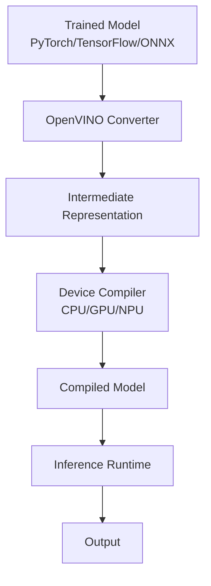

OpenVINO is an open-source toolkit designed to optimize and deploy deep learning models across diverse hardware platforms. Rather than locking developers into specific frameworks or devices, it provides a unified path from model training to inference, with particular emphasis on performance on edge devices and resource-constrained environments.

The toolkit addresses a real problem in production AI: trained models often run slowly or inefficiently when deployed to real hardware. OpenVINO sits between your trained model and the hardware it runs on, converting and optimizing the model for the specific device—whether that's a CPU, GPU, or specialized accelerator—without requiring the original training framework to be installed.

## Why it matters

Most deep learning workflows involve a disconnect between training and deployment. A model trained in PyTorch or TensorFlow works well in development but may be slow, memory-hungry, or incompatible with edge devices when deployed to production. Developers typically face a choice: keep the heavy training framework in production (wasteful), rewrite the model in a lighter format (error-prone), or accept poor performance.

OpenVINO bridges this gap. It accepts models from popular frameworks—PyTorch, TensorFlow, ONNX, Keras, PaddlePaddle, and JAX/Flax—and converts them into an optimized intermediate representation. This representation can then be compiled for specific hardware: Intel CPUs (x86 and ARM), Intel integrated and discrete GPUs, or Intel NPUs (neural processing units). The original framework doesn't need to be present at inference time.

This matters for several reasons. First, it reduces deployment complexity and resource footprint. Second, it enables deployment to edge devices where computational resources are limited. Third, it provides a consistent API across different hardware targets, so developers can write inference code once and run it on multiple devices. Fourth, it supports a broad range of AI tasks: computer vision, automatic speech recognition, natural language processing with large and small language models, and generative AI.

## How it works

OpenVINO's workflow follows a clear pipeline: load a model from a supported framework, convert it to OpenVINO's intermediate representation, compile it for a target device, and run inference.

### Model conversion and representation

The toolkit accepts models in their native formats (PyTorch, TensorFlow, etc.) and converts them into OpenVINO's internal representation. This conversion step is where optimization begins—the toolkit analyzes the model graph and applies transformations that prepare it for efficient execution on the target hardware.

### Device compilation

After conversion, the model is compiled for a specific device. Compilation is device-aware: the same model can be compiled differently for a CPU versus a GPU, with each compilation tuned to that hardware's strengths. The compiled model is what actually runs at inference time.

### Inference execution

At inference time, the compiled model receives input data and produces output. The OpenVINO runtime handles all hardware-specific details, presenting a unified API to the application.



### Framework support and ecosystem

OpenVINO integrates with the broader AI ecosystem. It works with Hugging Face's Optimum Intel to directly load and optimize transformer models. It supports PyTorch's torch.compile for JIT compilation. It can serve as a backend for ONNX Runtime and vLLM. The toolkit includes a separate GenAI API for optimized inference pipelines with large language models.

For advanced optimization, the ecosystem includes the Neural Network Compression Framework (NNCF), which provides quantization and sparsity techniques to further reduce model size and latency. There's also OpenVINO Model Server (OVMS) for scalable, high-performance model serving.

## How to try it

Installation is straightforward via pip:

```sh
pip install -U openvino
```

After installation, verify it works:

```python
import openvino as ov
print(ov.__version__)
```

The README includes two concrete examples. Here's the PyTorch path:

```python
import openvino as ov
import torch
import torchvision

# load PyTorch model into memory
model = torch.hub.load("pytorch/vision", "shufflenet_v2_x1_0", weights="DEFAULT")

# convert the model into OpenVINO model
example = torch.randn(1, 3, 224, 224)
ov_model = ov.convert_model(model, example_input=(example,))

# compile the model for CPU device
core = ov.Core()
compiled_model = core.compile_model(ov_model, 'CPU')

# infer the model on random data
output = compiled_model({0: example.numpy()})
```

And for TensorFlow:

```python
import numpy as np
import openvino as ov
import tensorflow as tf

# load TensorFlow model into memory
model = tf.keras.applications.MobileNetV2(weights='imagenet')

# convert the model into OpenVINO model
ov_model = ov.convert_model(model)

# compile the model for CPU device
core = ov.Core()
compiled_model = core.compile_model(ov_model, 'CPU')

# infer the model on random data
data = np.random.rand(1, 224, 224, 3)
output = compiled_model({0: data})
```

The project includes extensive tutorials and examples. The OpenVINO Notebooks repository covers LLM chatbots, YOLOv11 optimization, text-to-image generation, multimodal assistants, and automatic speech recognition. The documentation includes a quickstart guide and system requirements. For generative AI specifically, there's a separate GenAI installation path and detailed guide.

## Who it's for (and limits)

OpenVINO is built for developers and teams deploying AI models to production, particularly those targeting Intel hardware or edge devices. It's especially valuable if you:

- Train models in one framework but need to deploy without that framework present
- Need to run inference on edge devices with limited resources
- Want to support multiple hardware targets (CPU, GPU, NPU) from a single codebase
- Work with computer vision, NLP, speech recognition, or generative AI tasks
- Need to optimize model performance and reduce latency

The toolkit is open-source and community-driven, with active development and ecosystem integrations.

Limitations to note: OpenVINO is optimized for Intel hardware. While it supports ARM CPUs, its primary focus is Intel architectures. The material doesn't specify performance benchmarks or comparative metrics—check the official benchmarks page for detailed performance data. Support for specific model architectures or frameworks should be verified against the documentation.

## Links

- **Repository**: https://github.com/openvinotoolkit/openvino
- **Documentation**: https://docs.openvino.ai/2026/index.html
- **Key Features**: https://docs.openvino.ai/2026/about-openvino/key-features.html
- **Installation Guide**: https://docs.openvino.ai/2026/get-started/install-openvino.html
- **Tutorials**: https://docs.openvino.ai/2026/get-started/learn-openvino.html
- **Notebooks**: https://github.com/openvinotoolkit/openvino_notebooks
- **GenAI Repository**: https://github.com/openvinotoolkit/openvino.genai
- **Blog**: https://blog.openvino.ai

