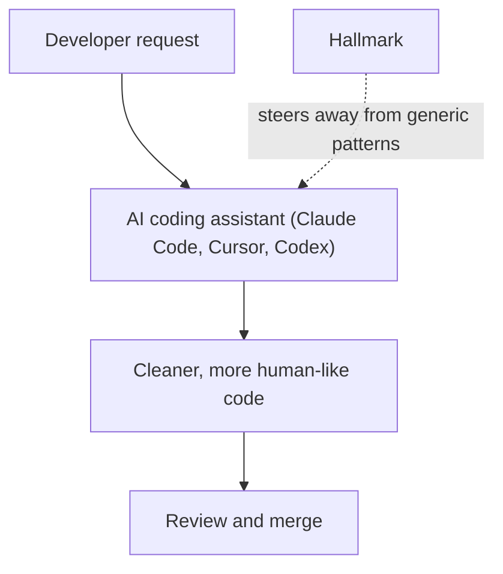

ב-15 ביולי 2026 היה Nutlope/hallmark בין מאגרי ה-AI שעלו בטרנדים של GitHub, עם 6,698 כוכבים. התיאור שלו קצר: הוא עוזר למפתחים לכתוב קוד נקי וטבעי יותר, על ידי הימנעות מהתבניות הגנריות שכלי קוד מבוססי AI נוטים לייצר — בכלים כמו Claude Code, Cursor ו-Codex.

## למה זה חשוב

מי ששילב עוזר קוד מבוסס AI מכיר את התחושה: הקוד עובד, אבל נקרא כאילו נכתב בוועדה. שמות גנריים, הערות שבלוניות ומבנה מגונן יתר על המידה מקשים על סקירה ותחזוקה. כלי שמכוון בדיוק לבעיה הזו נוגע בעלות אמיתית של פיתוח עם AI — זמן הסקירה.

וזה חשוב גם כי לפי התיאור הוא לא קשור לכלי אחד: הוא מכוון לעוזרים שמפתחים כבר משתמשים בהם (Claude Code, Cursor, Codex) ולא מבקש מהם לעבור לכלי אחר.

## איך זה עובד

הסיכום היומי שומר את תיאור הפרויקט והמספרים שלו, לא את המימוש הפנימי, ולכן החלק הזה נשאר בתוך מה שידוע: Hallmark יושב בין המפתח לבין עוזר הקוד ומכוון אותו הרחק מפלט גנרי. התרשים למטה הוא תמונה פשוטה של המקום הזה בתהליך העבודה, שנגזרה מהתיאור בן השורה. ה-README הוא המקור לאופן שבו הכלי עובד בפועל.

## במספרים

- **כוכבים ב-GitHub:** 6,698 ב-15 ביולי 2026 (מתוך הסיכום היומי של GitHub Trending).
- **מקור:** GitHub Trending, יומי.
- הרשימה המלאה של הבחירות באותו יום נמצאת בטבלת ההשוואה בסוף הפוסט.

## איך לנסות

הסיכום לא שומר שלבי התקנה, אז מתחילים מעמוד הפרויקט:

1. פותחים את ה[מאגר](https://github.com/Nutlope/hallmark) וקוראים את ה-README.
2. בודקים באילו עוזרים הוא תומך (התיאור מזכיר Claude Code, Cursor ו-Codex).
3. מנסים אותו על משימה קטנה ואמיתית אחת ומשווים את ה-diff עם הכלי ובלעדיו.

## למי זה מתאים (ומה המגבלות)

Hallmark מיועד למפתחים שכבר עובדים עם עוזרי קוד מבוססי AI ומקפידים על האופן שבו הקוד שנוצר נקרא. כמו בכל פרויקט צעיר, כדאי לבדוק רישיון, פעילות במאגר ותדירות עדכונים לפני שנשענים עליו בצוות.

## קישורים

- [Nutlope/hallmark ב-GitHub](https://github.com/Nutlope/hallmark)
- [כל הטרנדים ב-AI](/he/ai-trends)
