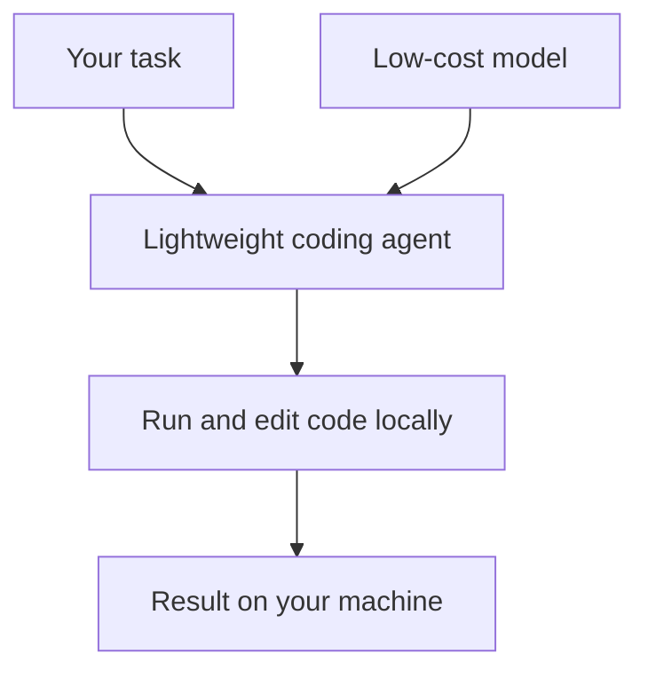

ב-15 ביולי 2026 היה openinterpreter/openinterpreter בטרנדים של GitHub עם 65,134 כוכבים. התיאור שלו: סוכן קוד AI קל משקל שמאפשר למודלים זולים להריץ ולערוך קוד מקומית על המחשב שלך — וכך כלי AI מתקדמים נגישים יותר בלי תלות ב-API של ענן.

## למה זה חשוב

רוב סוכני הקוד החזקים קשורים למודל ענן בתשלום. סוכן קל שעובד עם מודלים זולים ומריץ קוד מקומית משנה את הכלכלה: הקוד וההרצה נשארים אצלך במחשב, והעלות של ניסויים יורדת.

השילוב הזה — הרצה מקומית ומודלים זולים — הוא גם הסיבה שכדאי להכיר את הפרויקט גם בלי לאמץ אותו: הוא מראה לאן כלי הסוכנים הולכים.

## איך זה עובד

הסיכום שומר את תיאור הפרויקט והמספרים, לא את המימוש הפנימי, ולכן החלק הזה נשאר בתוך מה שידוע. התרשים הוא תמונה פשוטה של הזרימה שבתיאור בן השורה: משימה מגיעה לסוכן שנשען על מודל זול, והסוכן מריץ ועורך קוד על המחשב שלך. ה-README הוא המקור לארכיטקטורה האמיתית.

## במספרים

- **כוכבים ב-GitHub:** 65,134 ב-15 ביולי 2026 (מתוך הסיכום היומי של GitHub Trending).
- **מקור:** GitHub Trending, יומי.
- הרשימה המלאה של הבחירות באותו יום נמצאת בטבלת ההשוואה בסוף הפוסט.

## איך לנסות

הסיכום לא שומר שלבי התקנה, אז מתחילים מעמוד הפרויקט:

1. פותחים את ה[מאגר](https://github.com/openinterpreter/openinterpreter) וקוראים את ה-README.
2. שמים לב באילו מודלים הוא תומך ואיך הוא מבקש אישור לפני הרצת קוד.
3. מנסים אותו קודם בתיקייה זמנית — סוכן שמריץ קוד מקומית ראוי לארגז חול.

## למי זה מתאים (ומה המגבלות)

Open Interpreter מיועד למפתחים שרוצים סוכן שרץ על המחשב שלהם ועובד עם מודלים זולים. מכיוון שהוא מריץ קוד מקומית, כדאי לקרוא איך הוא מטפל בהרשאות ולסקור מה הוא מריץ לפני שמשתמשים בו על משהו חשוב.

## קישורים

- [openinterpreter/openinterpreter ב-GitHub](https://github.com/openinterpreter/openinterpreter)
- [כל הטרנדים ב-AI](/he/ai-trends)
