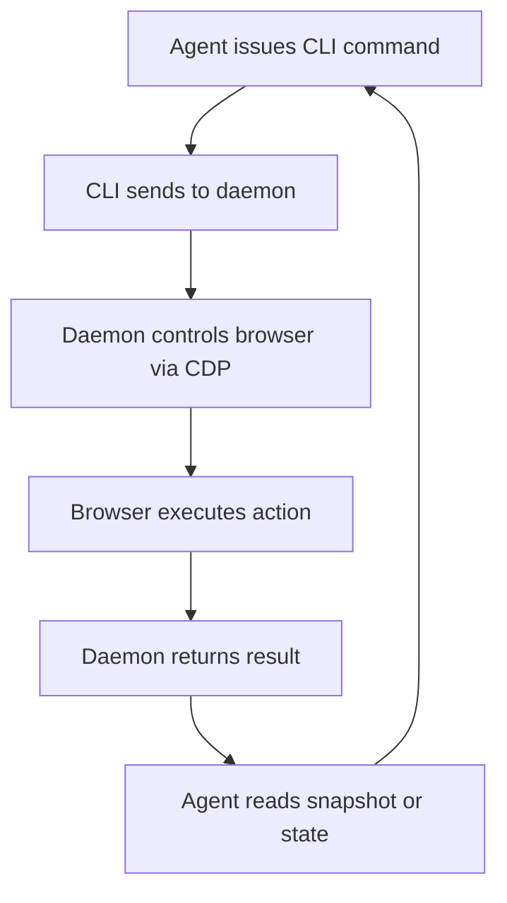

סוכנים AI צריכים לתקשר עם יישומי אינטרנט כמו בני אדם: פתיחת דפים, קריאת תוכן, לחיצה על כפתורים, מילוי טפסים. רוב כלי האוטומציה הקיימים תוכננו לסקריפטים או בדיקות, לא לסוכנים שחושבים על מה שהם רואים ומחליטים מה לעשות הלאה. agent-browser, מ-Vercel Labs, מתקרב לזה בצורה שונה. זהו כלי שורת פקודה שנכתב ב-Rust המתייחס לאוטומציה של דפדפן כשיחה: הסוכן לוקח תמונת מצב של הדף, מקבל ייצוג טקסט קומפקטי עם הפניות אלמנטים, פועל על הפניות אלו, וחוזר על התהליך.

הכלי זכה לתאוצה משמעותית—כמעט 50,000 כוכבים ב-GitHub—כי הוא פותר בעיה אמיתית בתחום תשתית הסוכנים המתהווה. במקום לחשוף DOM גולמי או פיקסלים של צילומי מסך, הוא נותן לסוכנים תצוגה מובנית וסמנטית של הדף שהיא גם קריאה למכונה וגם יעילה.

## למה זה חשוב

בניית סוכנים אוטונומיים שיכולים להתמודד עם משימות אינטרנט בעולם האמיתי דורשת יותר מאשר רק דרייבר דפדפן. זה דורש פרוטוקול המאפשר למערכת AI להבין מה נמצא בדף, לזהות אלמנטים שניתן לפעול עליהם, ולקבל משוב על תוצאות הפעולות שלה—הכל בצורה שחוסכת בטוקנים וקריאות API.

רוב כלי אוטומציה של דפדפן (Selenium, Puppeteer, Playwright) נבנו לסקריפטים דטרמיניסטיים או חבילות בדיקות. הם מחזירים HTML גולמי, צילומי מסך, או אירועים ברמה נמוכה. סוכן AI המשתמש בכלים אלו צריך או לנתח HTML ולחשוב על פריסה, או לנתח צילומי מסך ברמת פיקסל—שניהם יקרים ועלולים להיות שגויים.

agent-browser הופך את זה: הוא מחזיר את הדף כעץ נגישות קומפקטי עם הפניות סמנטיות. כל אלמנט אינטראקטיבי מקבל ref כמו `@e1`. הסוכן קורא את התמונת המצב, מחליט מה לעשות, משדר פקודה יחידה כמו `agent-browser click @e1`, והכלי מדווח על הצלחה או כישלון. הדפדפן נשאר פתוח בין פקודות, כך שכל שלב הוא קריאה אחת קצרה לשורת פקודה. עיצוב זה הופך את זה לפרקטי לסוכנים לאוטומציה של זרימות עבודה מורכבות—מילוי טפסים, ניווט רב-שלבי, לוגיקה מותנית—ללא התקורה של עיבוד מחדש של דף מלא או ניתוח צילומי מסך.

הכלי גם מגיע עם skills—הוראות מובנות שסוכנים יכולים לטעון כדי להבין כיצד להשתמש בו. זה מגשר בין כלי CLI לבין מסגרת סוכנים: הסוכן לא צריך ידע קודם של הפקודות; הוא יכול לבקש מהכלי ללמד אותו.

## איך זה עובד

### ארכיטקטורה וזרימת פקודות

agent-browser פועל כ-CLI מקורי ב-Rust המתקשר עם daemon ברקע. ה-daemon מתחיל בפקודה הראשונה ושולט בדפדפן דרך Chrome DevTools Protocol (CDP). כל session מקבל daemon וגרסת דפדפן משלו. כברירת מחדל, דפדפן headless נסגר ו-daemon יוצא לאחר שעה של חוסר פעילות, אם כי ניתן להגדיר התמדת session כדי לשמור מצב.



### תמונות מצב והפניות

דפוס האינטראקציה הליבה סובב סביב תמונות מצב. כאשר סוכן קורא `agent-browser snapshot`, הכלי מחזיר את הדף כטקסט קומפקטי. אלמנטים אינטראקטיביים—קישורים, כפתורים, inputs—מתויגים עם refs. לדוגמה, קישור עשוי להופיע כ:

```
- link "Learn more" [ref=e1]
```

הסוכן יכול אז לפעול על ה-ref הזה: `agent-browser click @e1`. Refs תקפים רק לתמונת המצב שהם הגיעו ממנה; אם הדף משתנה (ניווט, עדכון DOM), יש לקחת תמונת מצב חדשה לפני שמשתמשים ב-refs שוב.

הכלי גם תומך בבוררי CSS, XPath, התאמת טקסט, ומאתרים סמנטיים (למשל, `agent-browser find role button click --name "Submit"`), כך שלסוכנים יש גמישות בדרך שבה הם מכוונים אלמנטים.

### מנועי דפדפן וספקים

כברירת מחדל, agent-browser משתמש ב-Chrome for Testing. אבל זה לא נעול לדפדפן אחד. הכלי יכול להתחבר לגרסת Chrome פעילה דרך CDP mode, להחליף למנועים חלופיים כמו Lightpanda או Obscura, להנהיג Mobile Safari ב-iOS Simulator, או להתחבר לספקי דפדפן בענן—Browserbase, Browserless, Browser Use, Kernel, או AgentCore. גמישות זו אומר שסוכנים יכולים להסתגל לסביבות ודרישות שונות.

### טיפול בכישלונות

הכלי קפדני לגבי הצלחה. אם מטרת לחיצה מוסתרת, מנוטרלת, מחוץ לתצוגה, או מכוסה על ידי אלמנט אחר (כמו בנר הסכמה), הפעולה נכשלת במקום להצליח בשקט. זה מאלץ סוכנים להתמודד עם חיכוך בעולם האמיתי: לבטל את האלמנט המכסה, לקחת תמונת מצב חדשה, ולנסות שוב. זה בחירת עיצוב שמשקפת כיצד בני אדם מתקשרים עם האינטרנט.

## איך לנסות את זה

התקן דרך npm:

```bash
npm install -g agent-browser
agent-browser install           # download Chrome for Testing (first time only)
```

Homebrew זמין גם:

```bash
brew install agent-browser
agent-browser install
```

ב-Linux, השתמש ב-`agent-browser install --with-deps` כדי גם להתקין את ספריות המערכת של הדפדפן.

לאחר ההתקנה, פתח דף והתקשר:

```bash
agent-browser open example.com
agent-browser snapshot -i       # interactive elements, each with a ref
agent-browser click @e1         # act on a ref from that snapshot
agent-browser get url           # check the result
agent-browser close
```

לסוכנים AI, הכלי מגיע עם skills שניתן לטעון:

```bash
agent-browser skills get core                 # core loop, refs, waiting, workflows
agent-browser skills list                     # specialized skills: electron, slack, etc.
```

סוכנים יכולים גם להשתמש בשרת MCP (Model Context Protocol):

```bash
agent-browser mcp                             # starts MCP server over stdio
```

לקבלת הגדרה ותצורה מפורטות יותר, ראה את הסעיפים [Installation](https://agent-browser.dev/installation) ו-[Quick Start](https://agent-browser.dev/quick-start) בתיעוד.

## למי זה מיועד (והגבלות)

agent-browser תוכנן למפתחים הבונים סוכנים AI שצריכים לאוטומציה של משימות אינטרנט. זה שימושי במיוחד עבור:

- סוכנים שצריכים למלא טפסים, לנווט זרימות עבודה רב-שלביות, או להתקשר עם יישומי אינטרנט
- צוותים הבונים תשתית סוכנים ורוצים שכבת אוטומציה של דפדפן סטנדרטית ותכננה היטב
- מקרי שימוש שבהם יעילות טוקנים חשובה—תמונות מצב קומפקטיות בהשוואה ל-HTML מלא או צילומי מסך

הכלי אינו תחליף לאוטומציה בדיקות מסורתית (Playwright, Cypress) או ספריות web scraping. הוא מותאם למקרה השימוש של הסוכן: בקרה אינטראקטיבית וממוקדת חשיבה של דפדפן.

אילוץ חשוב אחד: refs ספציפיים לתמונת מצב. אם ה-DOM משתנה בין תמונת מצב לפעולה, refs הופכים לבלתי תקפים. סוכנים חייבים להיות מוכנים לקחת תמונות מצב חדשות ולנסות שוב. זה בעיצוב—זה מאלץ סוכנים לחשוב על שינויי מצב דף—אבל זה אומר שלולאת האינטראקציה אינה fire-and-forget.

הכלי פועל ב-macOS (ARM64, x64), Linux (ARM64, x64, glibc ו-musl), ו-Windows (x64), עם בינאריים מקוריים המופצים דרך npm.

## קישורים

- **Repository:** https://github.com/vercel-labs/agent-browser
- **Documentation:** https://agent-browser.dev
- **Commands reference:** https://agent-browser.dev/commands
- **Configuration:** https://agent-browser.dev/configuration

