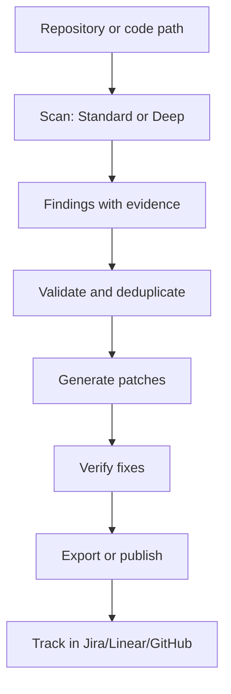

פגיעויות אבטחה בקוד יקרות למצוא ולתקן בשלבים מאוחרים של הפיתוח. Codex Security פותרת זאת על ידי אוטומציה של גילוי, חקירה וטיפול בבעיות אבטחה כחלק מזרימת העבודה הרגילה שלך. במקום להתייחס לסריקת אבטחה כשער נפרד, היא משתלבת ישירות בעורך שלך, בטרמינל וב-CI pipeline.

## למה זה חשוב

סקירות קוד אבטחה ידניות לא מתרחבות. כלים לניתוח סטטי יוצרים רעש. בדיקות חדירה מתרחשות מאוחר מדי. התוצאה היא שהרבה פגיעויות עוברות לייצור, מגולות רק לאחר פריסה או במהלך תגובה לתקרית.

Codex Security משנה את הציר הזה על ידי אוטומציה של כל מחזור חיי הפגיעויות: מציאת בעיות, אימות שהן אמיתיות (לא false positives), ייצור תיקונים ואימות תיקונים. מכיוון שהיא משתמשת בנימוק בינה מלאכותית ולא רק בהתאמת דפוסים, היא יכולה להבין הקשר - זרימות אימות, רגישות נתונים, מודלי איום ספציפיים ליישום שלך - במקום לסמן כל שימוש בפונקציה מיושנת.

הכלי משתלב גם עם התשתית האבטחה הקיימת שלך. אתה יכול לעקוב אחר ממצאים ב-Linear, Jira או GitHub; לייצא תוצאות ל-SARIF עבור מערכות CI; או לפרסם ל-Codex Security Cloud לראות הצוות. זה אומר שממצאי אבטחה הופכים לפריטי עבודה שניתן לפעול עליהם, לא לדוחות שיושבים ללא קריאה.

## איך זה עובד

Codex Security פועלת על פני שלוש ממשקים: בתוך Codex (עורך ה-AI), דרך CLI בשורת הפקודה, ודרך TypeScript SDK לאוטומציה.

### סריקה וחקירה

זרימת העבודה הבסיסית מתחילה בסריקה. אתה יכול לסרוק את כל המאגר שלך, נתיבים ספציפיים, או רק את השינויים שביצעת מאז גרסת בסיס (שימושי לבקשות pull). הכלי מציע שני מצבי סריקה:

- **סריקות סטנדרטיות** חוקרות את הקוד שלך לפגיעויות בתוך תקציב זמן שניתן להגדיר (ברירת מחדל או מותאם אישית, למשל 15 דקות).
- **סריקות עמוקות** חוזרות על החקירה הסטנדרטית ומחזירות ממצאים מבוטלים כפולים, בחילופי זמן לשביעות רצון.

לאחר השלמת סריקה, היא יוצרת דוח עם ראיות מקור והערות כיסוי - מה נבדק ומה הוחרג.

### אימות וטיפול

מציאת פגיעות פוטנציאלית היא רק הצעד הראשון. Codex Security מאמתת ממצאים מועמדים כדי להפחית false positives, ואז יוצרת תיקונים לבעיות מאומתות. אתה יכול גם לבקש ממנה לאמת שתיקון קיים בעצם פותר את הפגיעות.

### מדיניות ומודלינג איום

הכלי יכול לעצב או לעדכן קובץ `SECURITY.md` למאגר שלך, תוך שילוב הארכיטקטורה ומודל האיום שלך. סריקות משתמשות בהנחיה זו כדי להתמקד בסיכונים החשובים ליישום שלך. מודלי איום נשמרים עם תוצאות סריקה ויכולים להיות מיוצאים בנפרד לסקירה מאוחרת.

### אינטגרציה ומעקב

ניתן לפרסם ממצאים למערכות צד שלישי: Linear, Jira, GitHub Issues או Codex Security Cloud. דוחות יכולים להיות מיוצאים כ-SARIF (עבור מערכות CI), JSON או CSV. הכלי תומך גם בייבוא ממצאים מסורקי אבטחה אחרים וביטול כפילויות שלהם מול התוצאות שלו.



### אימות ואינטגרציה ענן

לשימוש ב-CLI ו-SDK, אתה מאמת דרך `cs login` (אינטראקטיבי) או על ידי הגדרת `OPENAI_API_KEY` או `CODEX_API_KEY` בסביבה שלך. עבור מכונות headless (CI runners, containers), התחברות התקן או SSH זמינה.

Codex Security Cloud הוא אופציונלי. סריקות מקומיות עובדות לחלוטין במצב offline; חיבור Cloud נדרש רק אם אתה רוצה לקרוא או לשתף ממצאים על פני הצוות שלך.

## איך לנסות זאת

### התחלה מהירה ב-CLI

Codex Security דורשת Node.js 22.13.0+ (בתוך 22.x) או Node.js 24.x או 26.x, בתוספת Python 3.10+. Python 3.10 דורש גם `tomli`.

```bash
npm install --global @openai/codex-security
cs login
cs scan .
```

כאשר הסריקה מסתיימת, פתח את קובץ הדוח Markdown המוצג בטרמינל. כדי למצוא סריקה קודמת:

```bash
cs scans show
```

### אפשרויות סריקה

```bash
# Scan specific paths
cs scan . --path src --path tests

# Scan only changes since a base branch
cs scan . --diff origin/main

# Run a deep scan
cs scan . --mode deep

# Set a time budget (advisory, in minutes)
cs scan . --max-time 15
```

השתמש ב-`cs --help` או `cs scan --help` לעיון הפקודה המלא.

### TypeScript SDK

לאוטומציה בקוד שלך:

```bash
npm install @openai/codex-security
```

```ts
import { CodexSecurity } from "@openai/codex-security";

const security = new CodexSecurity();

try {
  const result = await security.run("/path/to/repository");
  console.log(result.reportPath);
} finally {
  await security.close();
}
```

ראה את מדריך ה-SDK במאגר לתצורת סריקה עמוקה, סיווג חומרה וטיפול בתוצאות.

### GitHub Actions

הוסף את מפתח ה-API של OpenAI שלך כסוד מאגר (`CODEX_SECURITY_API_KEY`), ואז העתק את דוגמת זרימת העבודה השבועית מהמאגר ל-`.github/workflows/codex-security.yml`. הדוגמה מפעילה סריקה שבועית עם מגבלת עלות של $5 ודיווח ממצאים ללא כישלון העבודה.

### ייצור מדיניות אבטחה

```bash
cs policy .
cs policy . --path services/api --knowledge-base architecture.md
```

הכלי עוצב מדיניות מחוץ למאגר שלך. בדוק זאת, ערוך אם צריך, ואז העתק רק את קובץ `SECURITY.md` למאגר שלך.

## למי זה מיועד (והגבלות)

Codex Security מעוצבת עבור צוותים שרוצים סריקת אבטחה אוטומטית בעזרת AI משולבת בתהליך הפיתוח שלהם. היא עובדת טוב עבור:

- **צוותי פיתוח** המשתמשים ב-CLI או SDK לסריקה לפני דחיפת קוד.
- **צינורות CI/CD** המפעילים סריקות בבקשות pull או במרווחים מתוזמנים דרך GitHub Actions.
- **צוותי אבטחה** המשתמשים ב-Codex Security Cloud לעקוב אחר ממצאים על פני מאגרים מרובים.
- **ארגונים** שצריכים לייצא ממצאים לכלים קיימים (Jira, Linear, מערכות תואמות SARIF).

### אילוצים חשובים

- **מפתח API נדרש**: סריקות משתמשות ב-API של OpenAI וגורמות לעלויות. הכלי תומך בגבולות עלות ותקציבי זמן לשליטה בהוצאות.
- **ספקי מודל נתמכים**: הכלי עובד עם OpenAI, Amazon Bedrock ו-OpenRouter. בדוק את ה-README לתמיכה בספק הנוכחית.
- **גישת Cyber**: חלק מהבקשות cybersecurity וממצאים מוגנים דורשים Trusted Access for Cyber. חשבונות עם גישת Daybreak יכולים להצטרף דרך דגלי CLI.
- **גרסאות Node.js ו-Python**: דרישות גרסה ספציפיות חלות; בדוק את ה-README לפרטים מדויקים.
- **כיסוי סריקה**: סריקות דיווח מה נבדק ומה הוחרג; כיסוי תלוי בגודל המאגר, מצב הסריקה ותקציב הזמן.

לפרטים על היסטוריית סריקה, Git worktrees מקושרים, סריקות בתפזורת בקונטיינר ואינטגרציה עם סורקים של צד שלישי, ראה את תיעוד CLI ו-SDK במאגר.

## קישורים

- **מאגר**: https://github.com/openai/codex-security
- **תיעוד CLI ו-SDK**: ראה `sdk/typescript/docs/` במאגר
- **מדריך GitHub Actions**: ראה `github-action/README.md` במאגר
- **ייבוא סורקים ואינטגרציות**: ראה `docs/scanner-imports/README.md` ו-`docs/plugin-connectors.md` במאגר

