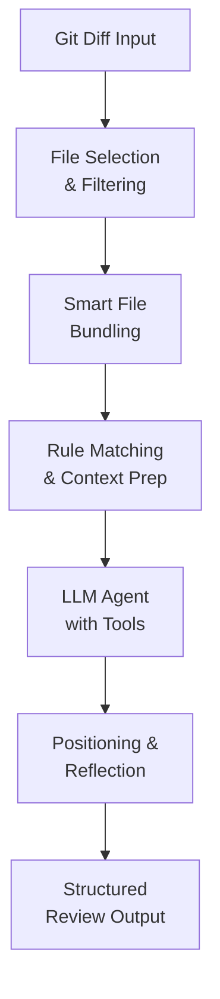

בדיקת קוד בקנה מידה גדול היא קשה. סוכני AI למטרות כלליות מצטיינים בחשיבה אך מתקשים בדיוק, עקביות ובדיוק מכני שבדיקת קוד דורשת. מערכת בדיקת הקוד הפנימית של Alibaba, שחוברה לשיפור במשך שנתיים והשוחררה כעת כ-Open Code Review, לוקחת גישה שונה: היא משלבת הנדסה דטרמיניסטית עם סוכני LLM, ומאפשרת לכל אחד להתמודד עם מה שהוא עושה הכי טוב.

הכלי קורא Git diffs, שולח קבצים שהשתנו ל-LLM שניתן להגדיר, וגנרט הערות בדיקה מובנות בדיוק ברמת השורה. הוא יכול לבדוק תוכן קבצים מלא, לחפש בקוד בסיס עבור הקשר, ולבדוק קבצים שלמים לביקורת קוד לא מוכר — לא רק משוב diff בעומק פני השטח. המערכת זיהתה מיליונים של פגמים בקוד ברחבי עשרות אלפי מפתחים ב-Alibaba, והחברה כעת פתחה את הקוד שלה לקהילה הרחבה יותר.

## למה זה חשוב

סוכנים למטרות כלליות כמו Claude Code with Skills הוכיחו שימושיים למשימות רבות, אך הם מציגים חולשות עקביות בבדיקת קוד:

- **כיסוי לא שלם** — בקבוצות שינויים גדולות יותר, סוכנים בוחנים בחירוני רק חלק מהקבצים, ומחמיצים שינויים חשובים.
- **סחיפת מיקום** — בעיות שדווחו לעתים קרובות אינן תואמות למיקומי קוד בפועל; מספרי שורות והפניות לקבצים סוחפות מהמטרה.
- **איכות לא יציבה** — הנחיית כללים מונעת בשפה טבעית קשה לניפוי, ואיכות הבדיקה משתנה עם שינויים קטנים בהנחיה.

כשלים אלה מתרחשים מכיוון שארכיטקטורות מונעות בשפה בלבד חסרות אילוצים קשים. בעיה שדווחה בשורה הלא נכונה מבזבזת זמן של מפתח. פגיעות אבטחה שהוחמצה בקבוצת שינויים גדולה מביסה את המטרה של בדיקה אוטומטית.

Open Code Review מתמודדת עם זה על ידי הפרדת חששות: לוגיקה דטרמיניסטית מטפלת במה שלא חייב ללכת לא בסדר, בעוד שהסוכן מטפל בהחלטות דינמיות. נתוני ההשוואה תומכים בפשרה זו. בהשוואה לסוכנים למטרות כלליות המשתמשים באותו מודל בסיס, Open Code Review משיגה דיוק ניכר יותר וציון F1 תוך צריכה של רק ~1/9 מהאסימונים והשלמת בדיקות מהר יותר. הפשרה היא זיכרון נמוך יותר — בחירה מכוונת המעדיפה פחות אזעקות שווא על פני גילוי פגמים מקסימלי.

ההשוואה עצמה משמעותית: 50 מאגרים פתוחים פופולריים, 200 בקשות משיכה אמיתיות, 10 שפות תכנות, ו-1,505 בעיות אמת קרקע מוערות שאומתו בצולב על ידי 80+ מהנדסים בכירים.

## איך זה עובד

הארכיטקטורה משלבת שתי אסטרטגיות משלימות:

### הנדסה דטרמיניסטית — אילוצים קשים

שלבי בדיקה מסוימים לא חייבים להיכשל, ולכן הם נשלטים על ידי לוגיקה הנדסית ולא על ידי פלט מודל שפה:

- **בחירת קבצים מדויקת** — קובעת בדיוק אילו קבצים זקוקים לבדיקה ואילו צריכים להיות מסוננים, מה שמבטיח שאף שינוי חשוב לא יוחמץ.
- **חבילת קבצים חכמה** — מקבצת קבצים קשורים ליחידת בדיקה אחת (לדוגמה, `message_en.properties` ו-`message_zh.properties` מקובצים יחד). כל חבילה פועלת כתת-סוכן עם הקשר מבודד, מה שמאפשר ביצועים יציבים בקבוצות שינויים גדולות מאוד ותומך בבדיקה במקביל.
- **התאמת כללים דקיקה** — משווה כללי בדיקה למאפייני כל קובץ באמצעות לוגיקת מנוע תבנית, ומשמרת את תשומת הדעת של המודל ממוקדת ומחסלת רעש מידע במקור. זה יציב וניתן לחיזוי יותר מהנחיית כללים מונעת בשפה בלבד.
- **מודולי מיקום וחשיבה חיצוניים** — מודולים עצמאיים משפרים באופן שיטתי הן את דיוק המיקום והן את דיוק התוכן של משוב AI.

### סוכן — קבלת החלטות דינמית

סוכן ה-LLM מרכז את כוחותיו במקום שהם חשובים ביותר:

- **הנחיות מכוונות לתרחיש** — תבניות הנחיה מעומקות המותאמות לבדיקת קוד, שיפור יעילות תוך הפחתת צריכת אסימונים.
- **ערכת כלים מכוונת לתרחיש** — נגזרת מניתוח עקבות קריאות כלים בנתוני ייצור בקנה מידה גדול, כולל התפלגויות תדירות קריאה וקצבי חזרה לכל כלי. התוצאה היא ערכת כלים בנויה למטרה יציבה וניתנת לחיזוי יותר לבדיקת קוד מאשר ערכת כלים סוכן גנרית.



המערכת יכולה לזהות בעיות אבטחה כמו SQL injection ו-XSS, והיא עובדת עם מודלים של OpenAI ו-Anthropic. הכלי כתוב ב-Go וזמין כ-CLI.

## איך לנסות את זה

### התקנה

Open Code Review זמין דרך npm:

```bash
npm install -g @alibaba-group/open-code-review
```

לאחר ההתקנה, הפקודה `ocr` זמינה בעולם. לשיטות התקנה אחרות (סקריפט התקנה, GitHub Release binary, מהמקור), בדוק את ה-README.

### הגדרה וביקורת

לפני בדיקת קוד, הגדר נקודת קצה של LLM:

```bash
ocr config provider          # Select a built-in provider or add a custom one
ocr config model             # Pick a model for the active provider
```

לאחר מכן בדוק קוד במצבים מרובים:

```bash
cd your-project

# Review all staged, unstaged, and untracked changes
ocr review

# Review changes in a branch since it diverged from main
ocr review --from main --to feature-branch

# Review a single commit
ocr review --commit abc123

# Full-file scan (review entire files, not just diffs)
ocr scan
ocr scan --path internal/agent

# Save results to a file
ocr review --format json --output result.json
```

אתה יכול גם להמשיך בביקורות שהופסקו:

```bash
ocr session list
ocr review --from main --to feature-branch --resume <session-id>
```

לפרטים מלאים על הגדרה, משתנים סביבה, ספקים מותאמים, ומצב הנחיה (כאשר סוכן מארח AI מבצע את הביקורת), ראה את ה-README.

## למי זה מיועד (וגבולות)

Open Code Review מעוצבת לצוותים שרוצים בדיקת קוד דטרמיניסטית ודיוקת ללא תקורת אזעקות שווא של סוכנים למטרות כלליות. היא עובדת בשפות תכנות מרובות ומשתלבת בצינורות CI.

הכלי דורש Git >= 2.41 לייצור diff, חיפוש קוד, ופעולות מאגר.

הפשרה בין דיוק לזיכרון פירושה שחלק מהפגמים עלולים להיות מחמיצים לטובת הפחתת רעש. זה מכוון — ההנחה היא שמפתחים מעדיפים פחות אזעקות שווא על פני תפיסה-הכל-בכל-עלות. צוותים עם פרופילי סיכון שונים צריכים להעריך את נתוני ההשוואה ולשקול את סובלנותם שלהם לבעיות שהוחמצו.

המערכת נבדקה בייצור בקנה מידה, אך כמו כל כלי מופעל בעזרת AI, התוצאות תלויות באיכות המודל והתצורה. בדוק את ה-README להגדרה מתקדמת וטיפול בבעיות.

## קישורים

- **מאגר:** https://github.com/alibaba/open-code-review
- **אתר רשמי:** https://open-codereview.ai
- **מערך השוואה:** זמין ב-Hugging Face (AACR-Bench)
- **התקנה והגדרה:** ראה את ה-README לשלבי הגדרה מפורטים, משתנים סביבה, והגדרת ספק מותאם

