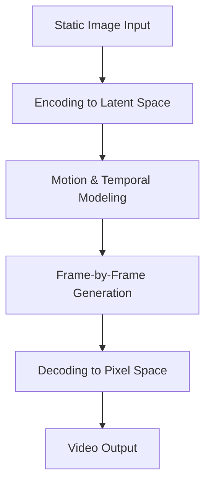

יצירת ווידאו מתמונה—המשימה של יצירת סדרות ווידאו דינמיות מתמונה סטטית אחת—נותרה אחד האתגרים המורכבים יותר בתחום בינה מלאכותית גנרטיבית. זה דורש מהמודל לא רק להבין הרכב מרחבי אלא גם לסנתז תנועה סבירה, שינויים בתאורה וקוהרנטיות זמנית על פני פריימים. LTX-2.5 של Lightricks הופיע כערך בולט בתחום זה, וצבר אימוץ קהילתי משמעותי ומדדי עיסוק המצביעים על תועלת מעשית.

## למה זה חשוב

יצירת ווידאו מתמונות פותרת פער זרימת עבודה אמיתי. יוצרי תוכן, מעצבים ומפתחים עובדים לעתים קרובות עם נכסים סטטיים—תמונות מוצרים, אמנות קונספט, רינדורים אדריכליים—והם צריכים לחקור כיצד הנושאים הללו עשויים להתנוע או להשתנות לאורך זמן. במקום לצלם צילומים חדשים או להנפיש פריימים ידנית, מודל המרת תמונה לווידאו יכול ליצור סדרות מועמדות בשניות.

מספרי האימוץ מספרים חלק מהסיפור. עם 2.7 מיליון הורדות ויותר מ-11,000 לייקים ב-Hugging Face, LTX-2.5 הפך למודל הטרנדי המובילה בהורדות בקטגוריה שלו. רמת עיסוק זו מצביעה על כך שהמודל פותר צורך אמיתי ופועל בצורה טובה מספיק כדי שמשתמשים יחזרו אליו ויוסיפו אותו לאחרים. ספירות הורדות גבוהות בתחום בינה מלאכותית גנרטיבית לעתים קרובות מתואמות עם שילוב של יכולת, קלות שימוש וموثוקות—אם כי הן אינן מבטיחות שום מדד יחיד של איכות.

## איך זה עובד

הפרטים הספציפיים של הארכיטקטורה של LTX-2.5 וגישת ההדרכה אינם מפורטים בחומר הסיכום הזמין. כדי להבין את ההטמעה הטכנית—כגון מבנה הרשת העצבית הבסיסית, נתוני הדרכה, פונקציות הפסד או אופטימיזציות הסקה—עליך להתייעץ עם ה-README המלא בכרטיס המודל.

מה שניתן לומר בדרך כלל על מודלים של המרת תמונה לווידאו הוא שהם בדרך כלל פועלים בשלבים:

הזרימה לעיל מייצגת דפוס נפוץ: תמונת קלט מקודדת לייצוג דחוס, מודל זמני חוזה כיצד ייצוג זה צריך להתפתח פריים אחר פריים, ומפענח משחזר ווידאו במרחב פיקסל מתחזוקות אלה. LTX-2.5 עשוי לעקוב אחר דפוס כללי זה או להשתמש בארכיטקטורה שונה; ה-README יבהיר את הפרטים.

## איך לנסות את זה

LTX-2.5 מתארח ב-Hugging Face וניתן לגשת אליו דרך כרטיס המודל בכתובת https://huggingface.co/Lightricks/LTX-2.5. ה-README בעמוד זה יכיל את ההוראות העדכניות ביותר להפעלת המודל, כולל:

- דרישות מערכת ותלויות
- שלבי התקנה
- דוגמאות קוד המראות כיצד לטעון את המודל וליצור ווידאו מתמונה
- אפשרויות פרמטר לשליטה בעיצוב פלט, אורך או סגנון

לקוד שימוש מדויק והליכי הגדרה, עיין ישירות ב-README במקום להסתמך על הנחיות כלליות, מכיוון שממשקי מודל ודרישות עשויים להשתנות.

## למי זה מיועד (ומגבלות)

LTX-2.5 כנראה שימושי עבור:

- **יוצרי תוכן** החוקרים תנועה לשיווק או מדיה חברתית
- **מעצבים ואמנים** שרוצים לתצוגה מקדימה של קונספטים סטטיים בתנועה
- **מפתחים** הבונים יישומים שצריכים יכולות יצירת ווידאו
- **חוקרים** החוקרים מודלים של ווידאו גנרטיבי

הפופולריות של המודל מצביעה על כך שהוא עובד היטב למקרי שימוש אלה, אך לכל מערכת המרת תמונה לווידאו יש מגבלות מובנות שכדאי להבין:

- **מציאות תנועה**: תנועה שנוצרה עשויה לא תמיד להתאים לפיזיקה בעולם האמיתי או לתנועה טבעית, במיוחד עבור אינטראקציות מורכבות.
- **עקביות זמנית**: עלולות להופיע חפצים או הבהוב על פני פריימים, במיוחד בסדרות ארוכות יותר.
- **הבנה סמנטית**: המודל עשוי להתקשות עם קונספטים מופשטים או הרכבים יוצאי דופן שהיו מתחת לייצוג בנתוני הדרכה.
- **עלות חישובית**: יצירת ווידאו היא יקרה מבחינה חישובית; זמן הסקה ודרישות זיכרון צריכים להיות מאומתים מול החומware שלך.
- **אורך פלט ורזולוציה**: בדרך כלל יש אילוצים על כמה זמן ווידאו יכול להיות וביאיזו רזולוציה ניתן ליצור אותו.

היכולות והמגבלות המדויקות של LTX-2.5 מובנות הטוב ביותר על ידי בדיקת כרטיס המודל וברצון לבדוק אותו על קלטים מייצגים הרלוונטיים למקרה השימוש שלך.

## קישורים

- **מודל**: https://huggingface.co/Lightricks/LTX-2.5
- **README ותיעוד**: זמין בעמוד כרטיס המודל (בדוק את כרטיסיית README לקבלת הגדרה, דוגמאות שימוש ופרטים טכניים)

