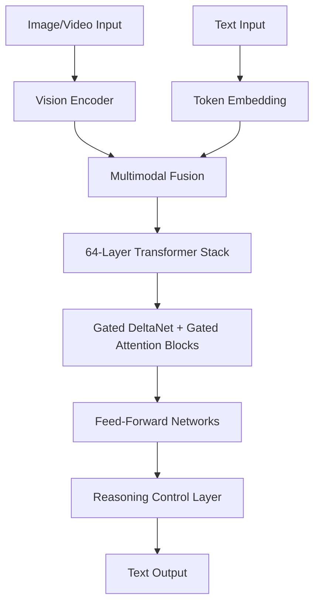

Qwen3.8-27B מייצג את האיטרציה האחרונה במשפחת מודלי השפה הפתוחים של אליבאבא, בנוי על הבסיס הארכיטקטוני של Qwen3.5 תוך הצגת שיפורים משמעותיים בקידוד, עבודה מקצועית, מחקר והוצאה לפועל של משימות סוכנים. כמודל מולטימודאלי, הוא מטפל בטקסט ותמונות באופן מקורי, וכרטיס המודל מציין שהוא יכול לעבד סרטונים גם כן. עם 6.5 מיליון הורדות ויותר מ-20,000 לייקים ב-Hugging Face, הוא השיג אימוץ משמעותי בקהילת ה-AI הפתוחה.

המודל מופץ בפורמט Hugging Face Transformers והוא תואם למסגרות הסקה פופולריות כולל vLLM, SGLang ו-TokenSpeed, מה שהופך אותו לנגיש הן לתרחישי מחקר והן לפריסה בייצור.

## למה זה חשוב

השחרור של Qwen3.8-27B מטפל בפער ספציפי בנוף המודלים הפתוחים: מודל צפוף קומפקטי וניתן לפריסה המשלב הבנת ראיית-שפה עם יכולות חשיבה המתאימות לסוכנים אוטונומיים וזרימות עבודה מרובות שלבים. עם 27 מיליארד פרמטרים, הוא נמצא בטווח מעשי לארגונים המחפשים להפעיל מודלים על חומרה ברמת צרכן או ארגונית צנועה מבלי להקריב יכולת.

התמיכה המקורית של המודל בתמונות וסרטונים רלוונטית במיוחד ליישומים בעולם האמיתי. כרטיס המודל מציין שהוא יכול להתמודד עם "דיאגרמות וניירות עבודה של STEM" כמו גם "סרטונים בקנה מידה של שעה", מה שמצביע על כך שהוא תוכנן עם מקרי שימוש מעשיים בחשבון מעבר לכתוביות תמונה פשוטות.

ההצגה של בקרת חשיבה גמישה—כאשר מצב חשיבה פעיל כברירת מחדל אך ניתן להשבית לכל בקשה, עם פרמטרים `reasoning_effort` הניתנים לכיוונון—מצביעה על בחירת עיצוב מכוונת לאיזון בין עלות הסקה לעומק חשיבה. גמישות זו מאפשרת למשתמשים להחליף בין זמן השהיה וחישוב לדיוק על בסיס לכל בקשה ולא להתחייב לתקציב חשיבה קבוע בזמן פריסה.

## איך זה עובד

### ארכיטקטורה וקנה מידה

Qwen3.8-27B הוא מודל שפה סיבתי עם מקודד ראיה משולב. רכיב מודל השפה מכיל 27 מיליארד פרמטרים המאורגנים על פני 64 שכבות. הממד הנסתר הוא 5,120, וממד הטמעת הטוקן הוא 248,320 (ממולא). המודל משתמש במנגנון תשומת לב היברידי:

- **שכבות Gated DeltaNet** (וריאנט תשומת לב ליניארית) עם 48 ראשי תשומת לב ליניארית לערכים ו-16 לשאילתה-מפתח, כל אחד עם ראשים בגודל 128 מימדים
- **שכבות Gated Attention** עם 24 ראשי שאילתה ו-4 ראשי מפתח-ערך, כל אחד עם ראשים בגודל 256 מימדים והטמעות עמדה סיבוביות בגודל 64 מימדים
- **רשתות feed-forward** עם ממד ביניים של 17,408

מבנה השכבה עוקב אחר דפוס חוזר: 16 בלוקים של (3 × (Gated DeltaNet → FFN) → 1 × (Gated Attention → FFN)).

### הקשר וחשיבה

המודל תומך באורך הקשר מקורי של 262,144 טוקנים והוא הרחיב לעד 1,000,000 טוקנים. הוא הוכשר עם חיזוי מרובה טוקנים (MTP) על פני מספר שלבים, טכניקה שיכולה לשפר הן יעילות והן איכות חשיבה.

מנגנון החשיבה פועל דרך שלושה פרמטרים בקרה: מצב חשיבה מופעל כברירת מחדל, `reasoning_effort` מאפשר כיוונון של עומק חשיבה, ו-`preserve_thinking` שומר הקשר חשיבה מהודעות היסטוריות בשיחות מרובות סיבובים.

### אינטגרציה ראיית-שפה

המודל כולל מקודד ראיה מקורי, המאפשר לו לעבד תמונות ופריימי סרטון ללא עיבוד מקדים חיצוני. כרטיס המודל אינו מספק פרטי ארכיטקטורה של מקודד הראיה עצמו; עיין ב-README לפרטים אלה.

## איך לנסות את זה

המודל זמין ב-Hugging Face בפורמט Transformers. לקבלת הוראות התקנה ושימוש ספציפיות, עיין ב-README במאגר המודל. כרטיס המודל מציין תאימות עם Hugging Face Transformers, vLLM, SGLang ו-TokenSpeed, כך שהאינטגרציה תלויה במסגרת ההסקה שבחרת.

לשימוש בהסקה מנוהלת ללא תחזוקת תשתית, אליבאבא מציעה גרסה מתארחת דרך Qwen Cloud. על פי כרטיס המודל, שירות Qwen3.8-27B המתארח "בקרוב" וכולל תכונות כגון אורך הקשר של 1M כברירת מחדל וכלים מובנים רשמיים. מידע נוסף זמין ב-Qwen3.8-27B Overview ב-Qwen Cloud.

## למי זה מיועד (והגבלות)

Qwen3.8-27B מתאים היטב ל:

- **זרימות עבודה של סוכנים**: כרטיס המודל מדגיש "תכנון אוטונומי חזק וטיפול טוב יותר בתגובות סביבה" להשלמת משימות מקצה לקצה.
- **משימות קידוד**: תוצאות ההשוואה מציגות ביצועים תחרותיים בקידוד סוכן טרמינל (Terminal Bench 2.1: 73.0), קידוד סוכן (SWE-bench Pro: 61.7), וייצור קוד ברמת מאגר (NL2Repo-Bench: 42.3).
- **הבנת מסמכים ודיאגרמות**: יכולות ראיה מקוריות תומכות בדיאגרמות STEM ובמסמכים מקצועיים.
- **חשיבה לטווח ארוך**: בקרת החשיבה הגמישה וחלון ההקשר המורחב תומכים בחשיבה מורכבת ורב-שלבית.
- **ארגונים עם אילוצי פריסה**: עם 27B פרמטרים, הוא ניתן לפריסה יותר מאשר מודלים גדולים יותר תוך שמירה על יכולת רחבה.

### אילוצים ידועים

כרטיס המודל אינו מספק מידע על מהירות הסקה, דרישות זיכרון, או תמיכה בכימות. הוא אינו מציין ביצועים על מדדי ראיית-שפה או משימות הבנת סרטונים מעבר לטענה הכללית של תמיכה. לקבלת מדדי ביצועים מפורטים והגבלות, בדוק את ה-README.

המודל משוחרר תחת רישיון Apache 2.0, המאפשר שימוש מסחרי עם ייחוס.

## קישורים

- **מאגר המודל**: https://huggingface.co/Qwen/Qwen3.8-27B
- **שירות Qwen Cloud המתארח**: https://www.qwencloud.com/models/qwen3.8-27b
- **README וכרטיס המודל**: זמין במאגר Hugging Face

