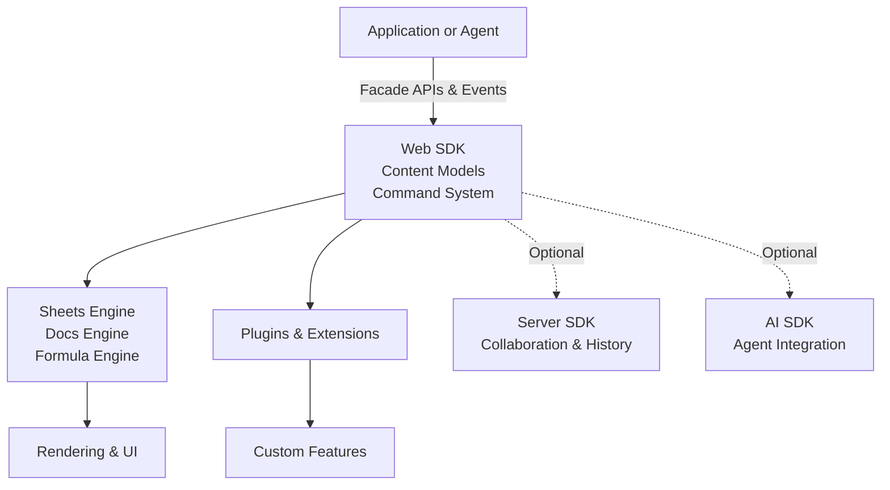

Univer היא Office SDK שמעניקה למפתחים את היכולת להטמיע עריכה ושיתוף פעולה ברמת Office ישירות לתוך המוצרים שלהם. במקום לבנות מאפס או להסתמך על שירותים חיצוניים, צוותים יכולים להרכיב רכיבים מודולריים של Univer—גיליונות אלקטרוניים, מסמכים, נוסחאות, שיתוף פעולה בזמן אמת—ליישומים מותאמים. הפרויקט צבר 27,461 כוכבים ב-GitHub וכתוב ב-TypeScript.

התובנה הליבה מאחורי Univer היא ארכיטקטורית: תוכנת Office מורכבת, אך חלקיה—מודלי תוכן, רינדור, חישוב, ביטול/ביצוע חוזר, הרשאות—ניתנים להפרדה ושימוש חוזר. הבסיס בקוד פתוח מכסה את שכבת Web SDK, בעוד שהרחבות מסחריות אופציונליות מוסיפות שיתוף פעולה בצד השרת, ייבוא/ייצוא קבצים ואינטגרציות של סוכני AI.

## למה זה חשוב

רוב המוצרים שצריכים יכולות Office עומדים בפני בחירה: לבנות מאפס (יקר, עתיר שגיאות), להטמיע שירות של צד שלישי (אובדן שליטה, חששות לגבי מקום הנתונים), או לרשום רישיון לתוכנה שולחנית (לא גמיש). Univer מציע דרך רביעית: השתמש בבסיס בקוד פתוח וניתן להרחבה שאתה שולט בו ויכול לשנות.

התזמון חשוב. כאשר סוכני AI וזרימות עבודה הופכים לשכיחים יותר, הם צריכים לתקשר עם נתונים מובנים—גיליונות אלקטרוניים, מסמכים, טבלאות. הארכיטקטורה של Univer מאפשרת לסוכנים להשתמש באותם ממשקים API כמו משתמשים אנושיים, לקרוא ולכתוב תוכן דרך ממשק עקבי. הליבה בקוד פתוח פירושה שאתה לא נעול לאסטרטגיית AI של ספק; אתה יכול לחבר את המודלים וההתאמה שלך.

לצוותים שבונים כלים פנימיים, יישומים הפונים ללקוחות, או זרימות עבודה של סוכנים, הטמעת עריכה של Office מונעת את המורכבות של שמירה על פורמטי נתונים נפרדים ולוגיקת סנכרון. התוכן נשאר במקום אחד, והעריכות זורמות דרך מערכת פקודות יחידה.

## איך זה עובד

Univer מאורגנת לשלוש שכבות:

**Web SDK** (בקוד פתוח, במאגר זה) מספקת את הבסיס: מודלי תוכן וקבצי snapshot, מערכת plugin עם dependency injection, מערכת פקודות לעריכות מתואמות, מנועי נוסחאות ורינדור, ו-Facade APIs (הממשק הציבורי ליישומים). אתה יכול להרכיב plugins לעורך משובץ או להשתמש במודלי התוכן והחישוב במצב headless—סקריפטים Node.js או שירותי backend—ללא כל ממשק משתמש.

**Server SDK** (מסחרי) מוסיף שירותי backend לשיתוף פעולה בזמן אמת, היסטוריית עריכה וייבוא/ייצוא של פורמטי קבצי Office.

**AI SDK** (הרחבות מסחריות זמינות) מחברת יכולות Office לסוכנים וזרימות עבודה, עם כלי תוכן, ביצוע ואינטגרציות סקירה.

היכולות בקוד פתוח כוללות:

- **Sheets**: סגנונות תא, תאים ממוזגים, טקסט עשיר בתא, הקפאת חלונות, תמונות צפות, ביטול/ביצוע חוזר, נוסחאות, שמות מוגדרים, סינון, מיון, אימות נתונים, עיצוב מותנה, היפר-קישורים, הערות וחיפוש והחלפה.
- **Docs**: עריכת טקסט עשיר, עיצוב פסקה, רשימות, היפר-קישורים, הערות ואינטגרציית ציור.

תכונה ארכיטקטורית מפתח היא **ביטול/ביצוע חוזר חוצה-תכונות**. כאשר אתה מוסיף שורה בתוך טווח מסונן, גם התוכן הבסיסי וגם מצב הסינון משתנים. כל תכונה מספקת את השינויים שלה ונתוני ביטול; מערכת הפקודות מרכיבה את ביצועם והיסטוריה. זה אומר שתכונות מותאמות יכולות להשתלב בצורה נקייה ללא יישום מחדש של לוגיקת ביטול.

מערכת ה-plugin משתמשת ב-dependency injection, כך שתכונות מצהירות מה הן צריכות והזמן ריצה מחבר אותן. עיצוב מבוסס גבול זה מקל על הוספת תכונות מותאמות ללא סבך עם קוד קיים.

## איך לנסות

ה-README מצביע על מדריך התחלה מהיר. לקבלת הוראות הגדרה מפורטות, בדוק את [קטע ההתחלה המהיר](https://github.com/dream-num/univer#quick-start) במאגר או את [התיעוד](https://docs.univer.ai/).

הפרויקט גם מספק:

- [השוואת תכונות](https://univer.ai/compare/) המציגה מה בקוד פתוח לעומת מסחרי.
- [הדגמות](https://univer.ai/demo/spreadsheets) חיות של גיליונות אלקטרוניים, מסמכים, שקופיות, טבלאות יחסיות, קנבסים ו-PDFs.
- [יישום ייחוס](https://github.com/dream-num/univer-workspace) בשם Univer Workspace המציג הגדרת Office SDK שלמה.
- [מדריך headless](https://docs.univer.ai/guides/sheets/getting-started/node) לשימוש ב-Univer ב-Node.js ללא ממשק משתמש.
- [ייחוס API](https://docs.univer.ai/reference/classes/univer) ו-[בלוג](https://docs.univer.ai/blog) לצלילות עמוקות יותר.

## למי זה מיועד (והגבלות)

Univer מתאימה ל:

- **צוותי מוצר** המטמיעים עריכה של Office ביישומי SaaS, ERPs או כלים פנימיים.
- **מפתחי סוכנים** הבונים זרימות עבודה שצריכות לקרוא ולכתוב נתונים מובנים.
- **מהנדסי backend** המעבדים קבצי Office או מריצים חישובים ב-Node.js.
- **צוותים הזקוקים לריבונות נתונים** שרוצים להימנע משירותים תלויים בענן.

Web SDK בקוד פתוח מספיק לרוב המקרים—עריכה משובצת, עיבוד headless ופיתוח תכונות מותאמות. שיתוף פעולה בזמן אמת, ייבוא/ייצוא קבצים ואינטגרציות סוכני AI דורשות הרחבות מסחריות, המופצות בנפרד.

הפרויקט נמצא תחת רישיון Apache-2.0 לליבה בקוד פתוח. plugins ו-SDKs מסחריים יש רישוי נפרד; בדוק את ה-README או האתר לפרטים.

הגבלה אחת: הבסיס בקוד פתוח מכסה Sheets ו-Docs. Slides, טבלאות יחסיות, קנבסים ו-PDFs מוצגים בהדגמות אך עשויים לדרוש הרחבות מסחריות או נמצאים בפיתוח. [השוואת התכונות](https://univer.ai/compare/) מבהירה מה זמין בכל שכבה.

## קישורים

- **מאגר**: https://github.com/dream-num/univer
- **תיעוד**: https://docs.univer.ai/
- **אתר**: https://univer.ai/
- **השוואת תכונות**: https://univer.ai/compare/
- **יישום ייחוס Workspace**: https://github.com/dream-num/univer-workspace
- **קהילה**: Discord, Twitter (@univerhq) ו-OpenCollective (קישורים ב-README)

