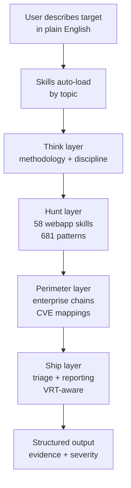

Claude-BugHunter היא חבילת כישורים עבור Claude Code שהופכת את המודל מעוזר כללי למטפל מתמחה בציד באגים ובעבודת צוות אדום. בנויה על ידי Sachin Sharma, היא משלבת 83 כישורים, 15 פקודות slash, ו-681 דפוסי חולשות שהוצגו לציבור—433 מהם מצוטטים בנפרד וניתנים לביקורת—מסודרים על פני 24 סוגי חולשות ליבה. החבילה מעוצבת להישאר בתחום, לעקוב אחר דיסציפלינה של צוות אדום, ולהטמיע את זרימות הגילוי, האימות וההדיווח שמאפיינות בדיקות אבטחה מקצועיות.

## למה זה חשוב

ציד בתגמול באגים ועבודת צוות אדום חיצוני דורשים מתודולוגיה עקבית, ידע עמוק של דפוסי חולשות, ודיסציפלינה תפעולית קפדנית. חוקר חייב לדעת לא רק *מה* לבדוק, אלא *איך* לבדוק זאת מבלי לחרוג מהתחום, כיצד לאמת ממצאים בקפדנות, וכיצד לדווח עליהם בפורמטים התואמים לטקסונומיית דירוג החולשות של כל פלטפורמה (HackerOne, Bugcrowd, Intigriti, Immunefi).

Claude-BugHunter פותר זאת על ידי קידוד הידע הזה ישירות למערכת הכישורים של Claude. במקום לבקש מהמודל ליצור payloads או מתודולוגיה מעקרונות ראשונים בכל פעם, החבילה מספקת דפוסים מעובדים ובדוקים בקרב שנחלצו מ-681 דוחות HackerOne שהוצגו לציבור. היא כוללת שרשראות פלטפורמה ארגוניות (M365, Okta, vCenter, מכשירי SSL-VPN, SharePoint) עם מיפויי CVE עדכניים מ-2024–2026, והיא אוכפת את "שער השאלות ה-7" לאימות triage—מסגרת החלטה מובנית שמפחיתה false positives והפרות תחום.

החבילה מעוצבת גם לעבודה על פני מספר harnesses של agents (Claude Code, OpenCode, OpenAI Codex CLI, Hermes Agent, Google AntiGravity), כלומר אותם כישורים יכולים להיות מופעלים בסביבות שונות ללא כתיבה מחדש.

## איך זה עובד

Claude-BugHunter מארגן בדיקות אבטחה לארבע שכבות מוערמות:

**Think** — שכבת המתודולוגיה והמנטליות. זה כולל את זרימת העבודה הלא-ליניארית בחמש שלבים, מסגרת חשיבה ביקורתית, וכללי דיסציפלינה של מפעיל צוות אדום שמשמרים בדיקות בתחום ומונעים טעויות נפוצות.

**Hunt webapps** — 58 כישורי hunt-* שנגזרו מ-681 דוחות שהוצגו לציבור. כל כישור מכסה סוג חולשות ספציפי (IDOR, SSRF, שרשראות RCE, עקיפת OAuth, התקפות JWT, העלאת קבצים וכו') וכולל דפוסי גילוי, payloads, טבלאות עקיפה, ותבניות שרשרת.

**Hit the perimeter** — שרשראות פלטפורמה ארגוניות עבור M365/Entra, Okta, vCenter, מכשירי SSL-VPN (Cisco, Fortinet, Citrix, Palo Alto, Pulse, SonicWall, F5), SharePoint, ותרחישי cloud misconfig. אלה כוללים שרשראות CVE עדכניות ונתיבי הסלמת הרשאות לאחר הצלחה.

**Ship it** — אימות triage, דיווח, וניקיון ראיות. שכבה זו כוללת את שער השאלות ה-7 להערכת חומרה, מיפויים המודעים ל-VRT עבור כל פלטפורמת תגמול, הפרכות out-of-scope, ניקוי PII, ועיצוב deliverables של צוות אדום.

כל הכישורים נטענים באופן אוטומטי בהתאם לתיאור המשתמש של מה שהם בודקים—אין צורך להפעיל אותם לפי שם. תאר "בדיקת acme.com, מטרה בתחום ב-HackerOne," והחבילה תטען כישורי web2-recon, offensive-osint, ו-bb-methodology באופן אוטומטי.



החבילה משתלבת עם Burp Suite דרך MCP (Model Context Protocol), המאפשר ל-Claude לתקשר עם נתוני proxy והיסטוריית בקשה/תגובה ישירות. היא כוללת גם scaffolder של engagement (`hunt` command) שמגדיר מבנה תיקייה ותבניות לעבודת צוות אדום מארגנת.

## איך לנסות זאת

**אפשרות A — התקנה כתוסף Claude Code (מומלץ):**

```text
/plugin marketplace add elementalsouls/Claude-BugHunter
/plugin install claude-bughunter@elementalsouls
```

כל 83 הכישורים ו-15 הפקודות נטענים עם namespace תחת `claude-bughunter:` ומתעדכנים באופן אוטומטי כאשר אתה מעדכן את גרסת התוסף.

**אפשרות B — התקנת copy (לקביעת גרסה ספציפית או שימוש ב-scaffolder של `hunt`):**

```bash
git clone https://github.com/elementalsouls/Claude-BugHunter.git
cd Claude-BugHunter

# macOS / Linux
bash scripts/install.sh

# Windows (PowerShell)
pwsh ./scripts/install.ps1
```

זה מעתיק כישורים ל-`~/.claude/` (macOS/Linux) או `%USERPROFILE%\.claude\` (Windows) ומאפשר את scaffolder של engagement של `hunt`.

נתיב התוסף הוא המהיר ביותר לגישה לכישורים. התקנת copy טובה יותר אם אתה רוצה את כלי ה-CLI (`cbh`) או את scaffolder של engagement. לפריסה של multi-harness (OpenCode, Hermes, Google AntiGravity וכו'), השתמש בדגל `--all`:

```bash
bash scripts/install.sh --all --burp-mcp
```

ראה את [Installation guide](https://github.com/elementalsouls/Claude-BugHunter/blob/main/INSTALL.md) ו-[Usage guide](https://github.com/elementalsouls/Claude-BugHunter/blob/main/USAGE.md) במאגר לשלבים מפורטים.

## למי זה מיועד (וגבולות)

**בתחום:**

- ציידי תגמול באגים בודקים אפליקציות אינטרנט, APIs, פלטפורמות SaaS, GraphQL, OAuth, וממשקי JWT
- penettesters מנהלים הערכות של יישומי אינטרנט
- מפעילי צוות אדום חיצוני תוקפים תשתית ארגונית פונה לאינטרנט (M365, Okta, vCenter, SSL-VPN, SharePoint)
- בדיקות cloud misconfig והסלמת הרשאות לאחר הצלחה
- עבודת OSINT ו-recon (enumeration של תת-דומיינים, מיפוי identity-fabric, certificate transparency, secret scanning)
- דיווח ל-HackerOne, Bugcrowd, Intigriti, Immunefi, וdeliverables של צוות אדום פונה ללקוח

**בכוונה out of scope:**

- התקפות Active Directory פנימיות (Kerberoasting, ASREProast, DCSync, שרשראות BloodHound)
- מסגרות C2 ו-tradecraft לאחר ניצול (Cobalt Strike, Sliver, persistence, lateral movement)
- עקיפת AMSI/ETW וחמקמקות AV/EDR
- בדיקות iOS, חומרה, RF, ו-ICS
- ניצול בינארי ו-kernel pwn

החבילה מעוצבת במפורש עבור משטח ההתקפה החיצוני. אם ה-engagement שלך כולל takeover של דומיין פנימי או lateral movement דרך Kerberos, תצטרך כלים נפרדים (Impacket, NetExec, CrackMapSec, Rubeus, Certify, BloodHound). ההעברה בין שלבי צוות אדום חיצוני ופנימי היא בכוונה—החבילה נשארת ממוקדת במה שהיא עושה טוב.

## קישורים

- **Repository:** https://github.com/elementalsouls/Claude-BugHunter
- **Installation guide:** https://github.com/elementalsouls/Claude-BugHunter/blob/main/INSTALL.md
- **Usage guide:** https://github.com/elementalsouls/Claude-BugHunter/blob/main/USAGE.md
- **Skill catalog:** https://github.com/elementalsouls/Claude-BugHunter/blob/main/docs/skills.md

