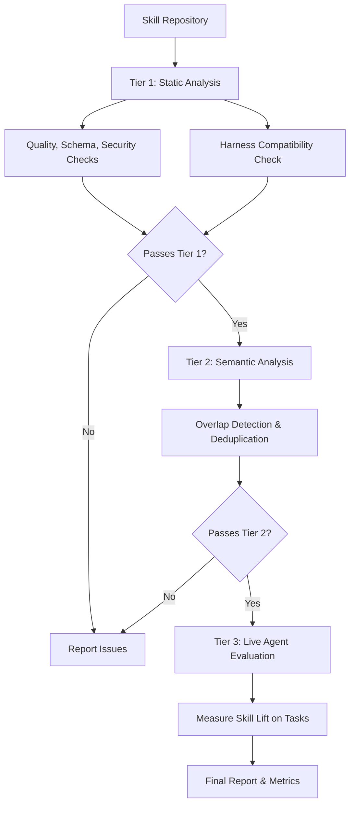

AI agents הופכים ליותר יכולים, אך היעילות שלהם תלויה במידה רבה בכישורים ובתוספים שהם יכולים לגשת אליהם. כישור שתוכנן בצורה גרועה יכול להחמיר את הביצועים, להציג סיכוני אבטחה, או לשכפל פונקציונליות שכבר קיימת במקום אחר. SkillEvaluator של NVIDIA פותרת בעיה זו על ידי הספקת מסגרת מובנית להערכת כישורי agent על פני מימדים מרובים — מבדיקות איכות סטטיות ועד בדיקות agent חיות — ללא צורך בצוותים לבנות ולתחזק תשתית הערכה מותאמת אישית.

הפרויקט, שצבר יותר מ-3,400 כוכבים ב-GitHub, נמצא בתוך צינור Verified Skills הרחב יותר של NVIDIA ומיישם את מפרט Agent Skills. הוא תוכנן לתפוס בעיות כישור לפני merge, להשתלב ישירות בזרימות CI/CD, ולמדוד את ההשפעה בפועל של כישור על השלמת משימות agent.

## למה זה חשוב

כישורי agent הם יחידות מודולריות של יכולת — תיקיות המכילות הוראות וקבצים תומכים שאותם agents יכולים לטעון ולהשתמש. ככל שמספר הכישורים הזמינים גדל, כך גדל הסיכון לשחרור קוד בעל איכות נמוכה, לא בטוח, או מיותר. בדיקה ידנית לא מתרחבת.

SkillEvaluator פותרת זאת על ידי אוטומציה של צינור ההערכה. היא מפעילה 11 בדיקות שונות שמגובות על ידי יותר מ-500 כללים סטטיים ודפוסי גילוי. אלה כוללים ניקוד איכות, אימות סכימה, גילוי PII, תאימות רישיון, Unicode linting, וסריקת אבטחה דרך SkillSpector, Gitleaks, Bandit, ואינטגרציית Semgrep אופציונלית.

המסגרת חוצה ניתוח סטטי. היא יכולה לגלות חפיפת כישורים — לזהות כאשר כישור חדש משכפל פונקציונליות שכבר זמינה — ולמדוד השפעה התנהגותית אמיתית על ידי הפעלת agents עם וללא הכישור כדי להשוות תוצאות משימות. מדידת "lift" זו קריטית: כישור שעובר את כל שערי האיכות אך לא באמת משפר את ביצועי agent לא שווה לשחרור.

עבור צוותים המנהלים מאגרי כישורים, SkillEvaluator מבטלת את הצורך לכתוב ולתחזק קוד הערכה. במקום זאת, הם מחברים את המאגר שלהם דרך תבנית CI ומגדירים סף. המסגרת מטפלת בשאר.

## איך זה עובד

SkillEvaluator פועלת בשלוש שכבות, כל אחת מוסיפה עומק להערכה:

**שכבה 1** פועלת באופן מקומי ללא מפתחות API או שירותים חיצוניים. היא מבצעת ניתוח סטטי: בדיקות איכות, אימות סכימה, בדיקות גרסה, סריקת PII, גילוי רישיון, Unicode ו-script linting, וסריקת אבטחה. רכיב Harness Check בוחן האם כישור יטען בפועל בסביבות agent ספציפיות (Codex, Claude Code, OpenCode, Hermes, OpenClaw, Copilot CLI) על ידי אימות פרופילי תאימות ובדיקת אילוצים כמו אורך תיאור וגבולות קידוד UTF-16.

**שכבה 2** מוסיפה דדופליקציה וניתוח סמנטי. היא משתמשת בהטבעות ובמודלי chat לגילוי כישורים חופפים וזיהוי פונקציונליות מיותרת.

**שכבה 3** מפעילה הערכת agent חיה. המסגרת פורסת את הכישור ל-agent אמיתי, מפעילה משימות עם וללא זה, ומודדת את ההשפעה ההתנהגותית בפועל.



בדיקת האיכות מייצרת ניקוד מתוך 100 עם ציון; סף ההעברה ברירת המחדל הוא 70. פלט Harness Check מציג מצב תאימות עבור כל פרופיל agent — האם כישור טוען, מתדרדר, או נכשל בטעינה, עם הערות אבחון ספציפיות.

לאינטגרציית CI, SkillEvaluator מספקת תבניות זרימת עבודה מוכנות לשימוש עבור GitHub ו-GitLab. תבניות אלה מפעילות בדיקות Tier 1 באופן אוטומטי על בקשות pull ללא דרישה למפתח API. זרימות עבודה אופציונליות יכולות להוסיף הערות PR עם תוצאות או לפרסם דוחות מתארחים.

## איך לנסות זאת

התקן את ה-CLI בסביבת Python 3.12–3.14:

```bash
pip install skillevaluator
```

לחלופין, באמצעות `uv`:

```bash
uv tool install --python 3.13 skillevaluator
```

הפעל בדיקת איכות בתיקיית כישור ללא מפתח API כלשהו:

```bash
skillevaluator quality-check ./my-skill
```

זה מייצר ניקוד וציון בהתאם לניתוח סטטי בלבד. אין צורך במפתח LLM, סורק, GPU, או Docker.

כדי לבדוק תאימות harness:

```bash
skillevaluator harness-check ./my-skill
```

זה מאמת האם הכישור יטען בסביבות agent שונות ודיווח בעיות תאימות ספציפיות.

כדי להפעיל את כל שלוש השכבות, תצטרך מפתח API של NVIDIA. חברים זכאים בתוכנית NVIDIA Developer Program יכולים להשיג מפתח חינם מ-[build.nvidia.com](https://build.nvidia.com/) לאב-טיפוס. לאחר הגדרה והתקנת החבילה המלאה, הפעל:

```bash
pip install "skillevaluator[all]"
export SKILL_EVAL_LLM_PROVIDER=nv_build
export NVIDIA_API_KEY='nvapi-...'
skillevaluator validate ./my-skill
```

כדי לשלב את SkillEvaluator בצינור CI של המאגר שלך, הפעל:

```bash
skillevaluator ci init
```

זה מנחה אותך דרך ההגדרה ויוצר PR עם תצורת זרימת העבודה המתאימה עבור GitHub או GitLab. לחלופין, העתק תבנית מלאה מראש מתיקיית `ci/bundles/` של המאגר.

לאפשרויות התקנה מפורטות, תצורה, והכנת מערך נתונים, ראה את התיעוד הרשמי המקושר להלן.

## למי זה מיועד (וגבולות)

SkillEvaluator תוכננה עבור צוותים הבונים ומתחזקים מאגרים של כישורי AI agent. היא בעלת ערך במיוחד עבור:

- **מחברי כישורים** שרוצים לאמת את עבודתם לפני הגשה
- **מתחזקי מאגר** שצריכים לאכוף תקנים איכות ואבטחה בקנה מידה
- **צינורות CI/CD** הדורשים הערכה אוטומטית ללא קוד מותאם אישית

המסגרת שימושית ביותר כאשר כישורים עוקבים אחר מפרט Agent Skills. צוותים המשתמשים בפורמטי כישור לא סטנדרטיים יצטרכו להסתגל.

בדיקות Tier 1 פועלות לחלוטין במצב לא מקוון וחינם. Tier 2 ו-Tier 3 דורשים ספק LLM ועלויות API או מגבלות קצב קשורות. מפתח NVIDIA Build החינם זמין רק לחברים זכאים בתוכנית Developer Program וכפוף לתנאי גישה ומגבלות קצב.

הערכת agent חיה (Tier 3) דורשת Docker לפעול ומערך נתונים הערכה שנבדק. זה מוסיף מורכבות תפעולית בהשוואה לבדיקות סטטיות בלבד.

הכלי מתוחזק בפעילות ותיעוד, עם כישור התייחסות כלול במאגר לבדיקה.

## קישורים

- **מאגר:** https://github.com/NVIDIA/SkillEvaluator
- **תיעוד:** https://docs.nvidia.com/skills/skillevaluator/
- **חבילת PyPI:** https://pypi.org/project/skillevaluator/
- **מאמר מחקר:** https://arxiv.org/abs/2608.20614
- **בלוג NVIDIA:** https://developer.nvidia.com/blog/evaluating-ai-agent-skill-performance-with-nvidia-skillevaluator/

