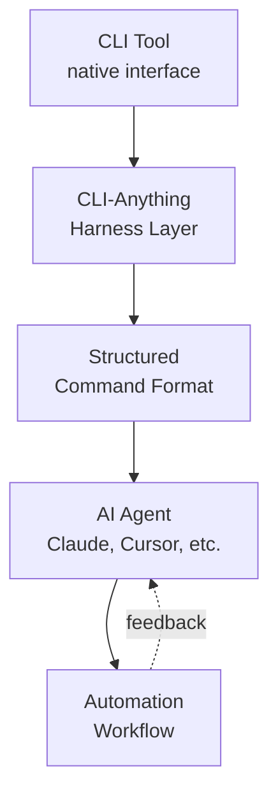

הפער בין תוכנת שורת-פקודה מסורתית וסוכני AI מודרניים היה נקודת חיכוך מעשית. רוב כלי ה-CLI תוכננו עבור אופרטורים אנושיים שמקלידים פקודות; סוכני AI זקוקים לממשקים מובנים וחזויים. CLI-Anything פותר זאת על ידי יצירת עטיפות תומכות-סוכנים סביב כלים קיימים של שורת-פקודה, מה שהופך אותם לשימושיים ישירות על ידי מערכות כמו Claude Code, Cursor וסוכני AI אחרים ללא צורך בשינויים לתוכנה המקורית.

הפרויקט צבר יותר מ-60,000 כוכבים ב-GitHub, מה שמעיד על עניין קהילתי משמעותי בבעיה שהוא פותר. התובנה הליבה פשוטה: במקום להמתין לכל ספק תוכנה לבנות API תומך-סוכנים, ליצור מסגרת שיכולה להתאים CLI קיימים לעבודה בצורה חלקה עם זרימות עבודה של אוטומציה AI.

## למה זה חשוב

אוטומציה תוכנה כיום מתמודדת עם בעיה מבנית. אלפים של כלים CLI בשלים ומתמחים קיימים—מעורכי וידאו למערכות GIS לתוכנת ייצור מוזיקה—אך הם נבנו לאינטראקציה אנושית. כאשר סוכן AI צריך להשתמש בכלים אלה, עליו או:

1. לנתח פלט טקסט לא מובנה ולהסיק כוונה מטקסט עזרה קריא לאדם
2. להמתין לספקים לבנות API של סוכנים (מה שנדיר עבור כלים ניישיים)
3. לדמות קלט מקלדת ועכבר (שביר וקטן)

CLI-Anything עוקף זאת על ידי יצירת שכבת הרתמה סטנדרטית. ברגע שכלי עטוף, כל מסגרת סוכן AI יכולה לתקשר איתו באמצעות מבני פקודה עקביים וקבוצות פלט חזויות. זה פותח אוטומציה על פני טווח הרבה יותר רחב של תוכנה מאשר היה מעשי אחרת.

הפרויקט גם מפעיל מערכת רישום (CLI-Hub) שבה חברי קהילה יכולים לתרום הרתמות לכלים חדשים. זה מפיץ את העבודה של אינטגרציה על פני תורמים רבים במקום לריכוז אותה.

## איך זה עובד

### ארכיטקטורה וייצור הרתמות

CLI-Anything עובד על ידי יצירת הרתמות מבוססות-Python שעוטפות כלים של CLI. כל הרתמה מתרגמת בין בקשות מובנות של הסוכן לממשק שורת-הפקודה המקורי של הכלי. המסגרת מספקת תבניות ועזריות כדי להפוך בניית הרתמות אלה לפשוטה.

ההרתמות מטפלות בכמה בעיות מעשיות:
- ניתוח וסטנדרטיזציה של פלט פקודה לפורמטים מובנים
- ניהול מצב כלי והגדרות
- טיפול בשגיאות ומקרים קצה ספציפיים לכל כלי
- מתן סוכנים עם תיאורים מדויקים של פקודות וממטרים זמינים

### רישום CLI-Hub

CLI-Hub (`pip install cli-anything-hub`) הוא מנהל חבילות להרתמות אלה. משתמשים יכולים לעיין בממשקי CLI זמינים, להתקין אותם עם `cli-hub install <name>`, וניהול עדכונים. הרישום כולל הן הרתמות שנבנו על ידי CLI-Anything והן CLI ציבוריים ממקורות שונים (pip, npm, brew, כלים מצורפים).

על פי החומר, הרישום תומך במקורות התקנה מרובים וכולל מטא-נתונים לגילוי. הממשק האינטרנט ב-https://hkuds.github.io/CLI-Anything/ מאפשר עיון בכלים זמינים.

### מודל תרומה קהילתי

הפרויקט מקבל תרומות דרך בקשות pull. הרתמות חדשות עוברות סקירה לפני מיזוג לרישום הציבורי. תורמים יכולים להירשם דרך תבנית בעיות GitHub, וברגע שמוזגו, מקבלים הכרה כתורמי קהילה.



## איך לנסות זאת

ה-README מציין התקנה דרך pip:

```bash
pip install cli-anything-hub
cli-hub install <name>
```

לשימוש בכלי ספציפי ופקודות זמינות, בדוק את [README של CLI-Anything](https://github.com/HKUDS/CLI-Anything) ו[ממשק האינטרנט של CLI-Hub](https://hkuds.github.io/CLI-Anything/), המפרט את כל ההרתמות הזמינות והתיעוד שלהן.

כדי לבקש תמיכה לכלי ספציפי, הפרויקט מקבל בקשות רשימת משאלות דרך בעיות GitHub. כדי לבנות הרתמה חדשה, תורמים יכולים לפתוח בעיית רישום תורם ולעקוב אחר הנחיות התרומה במאגר.

## למי זה מיועד (והגבלות)

CLI-Anything שימושי ביותר עבור:

- **מפתחי סוכני AI** הבונים מערכות אוטומציה שצריכות לשלוט בתוכנה קיימת
- **ארגונים** עם כלים מיוחדים של CLI שצריכים להשתלב בזרימות עבודה של סוכנים
- **קהילות קוד פתוח** המתחזקות כלים שרוצים תאימות סוכנים ללא בניית API משלהם

המסגרת עובדת הטובה ביותר עם כלים שיש להם ממשקי שורת-פקודה יציבים וטקסט-מבוססים. כלים עם מצבים אינטראקטיביים מורכבים, תלויות GUI כבדות, או קבוצות פלט המשתנות בתדירות עשויים להיות קשים יותר לעטיפה בצורה יעילה.

ההיקף של הפרויקט הוא ספציפית כלים של CLI. תוכנה ללא ממשקי שורת-פקודה תדרוש גישות שונות (אוטומציה GUI, עטיפת API וכו').

החומר אינו מספק מדדי ביצועים, מדידות זמן-תגובה, או השוואות עם גישות אינטגרציה חלופיות, כך שפרטים אלה יהיה צורך לבדוק בתיעוד המלא או דרך בדיקה.

## קישורים

- **מאגר**: https://github.com/HKUDS/CLI-Anything
- **ממשק אינטרנט של CLI-Hub**: https://hkuds.github.io/CLI-Anything/
- **חבילת CLI-Hub**: `pip install cli-anything-hub`
- **מדריך תרומה**: ראה CONTRIBUTING.md במאגר
- **מאמר מחקר**: arxiv.org/abs/2606.03854 (מוזכר ב-README)

