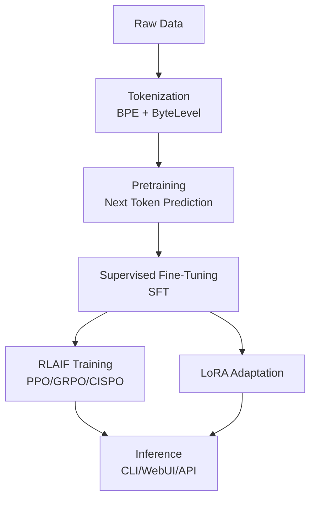

רוב פרויקטי מודלי שפה מניחים שיש לך גישה למשאבי חישוב ענקיים. MiniMind לוקח את הגישה ההפוכה: הוא מדגים שאתה יכול להדרך מודל שפה עובד מאפס על GPU יחיד של NVIDIA 3090 בעד כ-2 שעות, בהוצאה של בערך $3 על חישוב בענן. הפרויקט כולל קוד הדרכה שלם, צינורות נתונים והטמעות הסקה—הכל כתוב מעקרונות ראשונים באמצעות PyTorch, ללא הסתמכות על הפשטות מסגרת ברמה גבוהה.

המודל הליבה הוא בערך 64 מיליון פרמטרים, מה שהופך אותו לבערך 1/2700 מגודלו של GPT-3. למרות קנה המידה הקטן שלו, MiniMind מיישם את הצינור המלא שמודלים גדולים יותר משתמשים בו: pretraining, supervised fine-tuning (SFT), reinforcement learning from AI feedback (RLAIF), שימוש בכלים ויכולות חשיבה.

## למה זה חשוב

פיתוח מודלי שפה הפך לשמור על ידי קנה מידה חישובי. רוב ההדרכות מתמקדות בעדכון מודלים קיימים עם LoRA, מה שמלמד אותך כיצד להשתמש בכלי אך לא כיצד הוא עובד מבפנים. MiniMind הופך זאת: הוא מעוצב כפרויקט חינוכי שבו כל שורה של קוד אלגוריתם ליבה מיושמת מאפס, מה שהופך את הפנימיות לנראית והבנה.

הפרויקט מכוון לשתי קהלים: מפתחים שרוצים להבין כיצד מודלי שפה באמת עובדים, ומעשיים שצריכים להדרך מודלים על תשתית פרטית או נתונים מותאמים אישית ללא תקציבים ענקיים. על ידי הוכחה שהדרכת מודל משמעותית אפשרית על חומware צרכני, היא מסירה מחסום משמעותי לניסוי.

זמן ההדרכה של 2 שעות והעלות של $3 נמדדים לשלב ה-SFT (supervised fine-tuning) על 3090 יחיד, בהפעלה של epoch אחד דרך נתוני ההדרכה. זה מוצג כקו בסיס מעשי, לא כמינימום תיאורטי.

## איך זה עובד

MiniMind מיישם צינור הדרכה שלם של מודל שפה. הארכיטקטורה מתיישרת עם דפוסי עיצוב של Qwen3/Qwen3-MoE וכוללת גם וריאנטים צפופים וגם mixture-of-experts (MoE).



### שלבי הדרכה

הפרויקט מכסה את השלבים הרציפים הללו:

- **Pretraining**: חיזוי next-token סטנדרטי על קורפוס של טקסט. מערך הנתונים ברירת המחדל הוא `pretrain_t2t(_mini).jsonl`.
- **Supervised Fine-Tuning (SFT)**: הדרכה על זוגות הנחיה-תגובה כדי לגרום למודל לעקוב אחר הנחיות. משתמש ב-`sft_t2t(_mini).jsonl`.
- **RLAIF**: reinforcement learning from AI feedback באמצעות אלגוריתמים PPO, GRPO או CISPO. מדרך על `rlaif.jsonl`.
- **Tool Use & Agentic RL**: הדרכה מיוחדת לתרחישי tool-calling רב-תורניים עם `agent_rl.jsonl` ו-`agent_rl_math.jsonl`.

### תכונות ארכיטקטוניות עיקריות

- **Tokenizer**: tokenizer מותאם אישית מבוסס BPE עם תמיכה בטוקנים מיוחדים כמו `<tool_call>`, `<tool_response>` ו-`<think>` לחשיבה.
- **Reasoning**: יכולת חשיבה אדפטיבית המנוהלת דרך תבניות צ'אט ותגי `<think>`. ניתן להפעיל או לכבות חשיבה ללא הדרכה נפרדת של מודל.
- **Tool calling**: משולב בצינור נתוני SFT הראשי; לא נדרשת הדרכה נפרדת ליכולת tool-use בסיסית.
- **Long context**: תומך באלגוריתם YaRN לאקסטרפולציה של קידוד עמדה RoPE כדי להתמודד עם רצפים ארוכים יותר.
- **Model variants**: מודלים צפופים (~64M פרמטרים) ומודלים MoE (~198M פעילים, 64M לכל expert) זמינים שניהם.

### גישת יישום

כל האלגוריתמים הליבה—כולל LoRA, DPO, PPO, GRPO וזיקוק מודל—מיושמים ישירות ב-PyTorch ללא עטיפת הפשטות מסגרת של צד שלישי. זה הופך את הקוד לשקוף אך גם אומר שאתה קורא את לולאות ההדרכה בפועל במקום להתקשר ל-APIs ברמה גבוהה.

הפרויקט תומך בהדרכה מופצת דרך DDP (Distributed Data Parallel) ו-DeepSpeed בהגדרות multi-GPU, תוך שהוא נשאר ניתן להפעלה על GPU יחיד לניסוי.

## איך לנסות את זה

### התקנה

```bash
git clone --depth 1 https://github.com/jingyaogong/minimind
cd minimind && pip install -r requirements.txt -i https://mirrors.aliyun.com/pypi/simple
```

### הפעלת הסקה

הורד מודל מ-ModelScope או Hugging Face:

```bash
modelscope download --model gongjy/minimind-3 --local_dir ./minimind-3
```

לאחר מכן הפעל את ה-CLI:

```bash
python eval_llm.py --load_from ./minimind-3
```

או הפעל את ממשק האינטרנט (דורש Streamlit):

```bash
cd scripts && streamlit run web_demo.py
```

ממשק האינטרנט תומך בשיחה רב-תורנית, בחירת כלים והצגת חשיבה.

### הדרכה מאפס

לקבלת הנחיות הדרכה מפורטות, בדוק את ה-README במאגר. התהליך כולל:

1. הורדת מערכי נתונים מהקישורים המסופקים והצבתם ב-`./dataset`
2. הפעלת pretraining עם `train_pretrain.py`
3. הפעלת SFT עם `train_sft.py`
4. הפעלה אופציונלית של RLAIF או שלבי הדרכה מתקדמים אחרים

ה-README מכיל פקודות ספציפיות ואפשרויות תצורה לכל שלב.

### תמיכה במסגרת צד שלישי

המודל תואם עם:
- ספריית `transformers` (פורמט Hugging Face סטנדרטי)
- `llama.cpp` (הסקה מקומית)
- `vllm` (הגשה בתפוקה גבוהה)
- `ollama` (פריסה פשוטה)
- `Llama-Factory` (מסגרת הדרכה)

## למי זה מיועד (וגבולות)

**מתאים ביותר ל:**
- סטודנטים וחוקרים הלומדים כיצד מודלי שפה עובדים מבפנים
- מפתחים המדרכים מודלים על נתונים פרטיים או תחומים מותאמים אישית
- כל מי שמנסה שינויים בארכיטקטורה של מודל או אלגוריתמים הדרכה
- פרויקטים שבהם מהירות הסקה או גודל מודל מוגבלים

**מגבלות להבנה:**

- ב-64M פרמטרים, MiniMind הוא הרבה יותר קטן מאשר מודלים בייצור. זה כלי הוראה והוכחת קונספט, לא תחליף למודלים גדולים יותר.
- זמן ההדרכה של 2 שעות חל רק על שלב ה-SFT על 3090 יחיד. pretraining מלא לוקח יותר זמן.
- הדרכה על חומware צרכני פירושה איטרציה איטית יותר בהשוואה להגדרות בקנה מידה של מרכז נתונים.
- המודל מודרך בעיקר על נתונים סיניים, אם כי כמה יכולות אנגלית כלולות.

הפרויקט מיצב עצמו במפורש כחומר חינוכי המשולב עם קוד עובד, לא כמערכת מוכנה לייצור.

## קישורים

- **Repository**: https://github.com/jingyaogong/minimind
- **Model collection**: https://huggingface.co/collections/jingyaogong/minimind
- **Dataset**: זמין דרך ModelScope (בדוק README לקישורי הורדה)
- **Online demo**: זמין ב-ModelScope ו-Hugging Face Spaces (ראה README)

