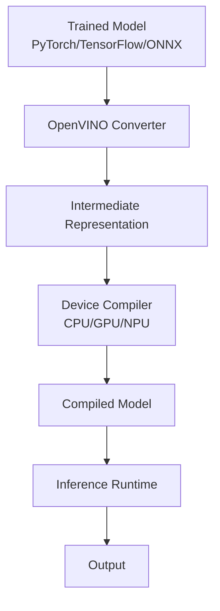

OpenVINO היא ערכת כלים בקוד פתוח שתוכננה לשיפור ופריסת מודלי deep learning על פלטפורמות חומware מגוונות. במקום לנעול מפתחים לפריימוורקים או התקנים ספציפיים, היא מספקת נתיב מאוחד מהכשרת מודל ועד inference, עם דגש מיוחד על ביצועים בהתקנים edge וסביבות עם משאבים מוגבלים.

ערכת הכלים פותרת בעיה אמיתית ב-AI בייצור: מודלים מאומנים לעתים קרובות רצים לאט או בצורה לא יעילה כשהם פורסים לחומware אמיתי. OpenVINO מתערבת בין המודל המאומן שלך לחומware שעליו הוא רץ, המרה ושיפור המודל עבור ההתקן הספציפי—בין אם זה CPU, GPU או מאיץ מיוחד—ללא צורך בהתקנת הפריימוורק המקורי.

## למה זה חשוב

רוב זרימות העבודה של deep learning כרוכות בניתוק בין הכשרה ופריסה. מודל שהוכשר ב-PyTorch או TensorFlow עובד טוב בפיתוח אך עלול להיות איטי, צורך בזיכרון רב, או לא תואם להתקנים edge כשהוא פורס לייצור. מפתחים בדרך כלל עומדים בפני בחירה: להשאיר את הפריימוורק הכבד בייצור (בזבזני), לכתוב מחדש את המודל בפורמט קל יותר (עלול להכיל שגיאות), או לקבל ביצועים גרועים.

OpenVINO גשרת על הפער הזה. היא מקבלת מודלים מפריימוורקים פופולריים—PyTorch, TensorFlow, ONNX, Keras, PaddlePaddle ו-JAX/Flax—והמרה אותם לייצוג ביניים משופר. ייצוג זה יכול להיות מהודר עבור חומware ספציפי: Intel CPUs (x86 ו-ARM), Intel integrated ו-discrete GPUs, או Intel NPUs (neural processing units). הפריימוורק המקורי לא צריך להיות קיים בזמן inference.

זה חשוב מכמה סיבות. ראשית, זה מקטין את מורכבות הפריסה וטביעת הרגל של משאבים. שנית, זה מאפשר פריסה להתקנים edge שבהם משאבי חישוב מוגבלים. שלישית, זה מספק API עקבי על פני מטרות חומware שונות, כך שמפתחים יכולים לכתוב קוד inference פעם אחת ולהריץ אותו על מספר התקנים. רביעית, היא תומכת בטווח רחב של משימות AI: computer vision, automatic speech recognition, עיבוד שפה טבעית עם מודלים שפה גדולים וקטנים, ו-AI generative.

## איך זה עובד

זרימת העבודה של OpenVINO עוקבת אחר pipeline ברור: טעינת מודל מפריימוורק תומך, המרתו לייצוג הביניים של OpenVINO, הידור עבור התקן יעד, והרצת inference.

### המרת מודל וייצוג

ערכת הכלים מקבלת מודלים בפורמטים הנטיביים שלהם (PyTorch, TensorFlow וכו') והמרה אותם לייצוג הפנימי של OpenVINO. שלב ההמרה הזה הוא המקום שבו השיפור מתחיל—ערכת הכלים מנתחת את גרף המודל ומיישמת טרנספורמציות המכינות אותו להרצה יעילה על חומware היעד.

### הידור התקן

לאחר ההמרה, המודל מהודר עבור התקן ספציפי. הידור הוא device-aware: אותו מודל יכול להיות מהודר בצורה שונה עבור CPU לעומת GPU, כאשר כל הידור מכוונן לחוזקות של אותו חומware. המודל המהודר הוא מה שבעצם רץ בזמן inference.

### הרצת Inference

בזמן inference, המודל המהודר מקבל נתוני קלט ומייצר פלט. ה-runtime של OpenVINO מטפל בכל הפרטים הספציפיים לחומware, ומציג API מאוחד ליישום.



### תמיכה בפריימוורקים ומערכת אקולוגית

OpenVINO משתלבת עם מערכת האקולוגית של AI הרחבה יותר. היא עובדת עם Optimum Intel של Hugging Face כדי לטעון ולשפר מודלים של transformer ישירות. היא תומכת ב-torch.compile של PyTorch עבור JIT compilation. היא יכולה לשמש כ-backend עבור ONNX Runtime ו-vLLM. ערכת הכלים כוללת GenAI API נפרדת עבור pipelines inference משופרים עם מודלים שפה גדולים.

לשיפור מתקדם, המערכת האקולוגית כוללת את Neural Network Compression Framework (NNCF), המספקת טכניקות quantization ו-sparsity כדי להקטין עוד יותר את גודל המודל וה-latency. יש גם OpenVINO Model Server (OVMS) עבור serving מודלים scalable וביצועים גבוהים.

## איך לנסות את זה

ההתקנה פשוטה דרך pip:

```sh
pip install -U openvino
```

לאחר ההתקנה, אמת שזה עובד:

```python
import openvino as ov
print(ov.__version__)
```

ה-README כולל שתי דוגמאות קונקרטיות. הנה נתיב PyTorch:

```python
import openvino as ov
import torch
import torchvision

# load PyTorch model into memory
model = torch.hub.load("pytorch/vision", "shufflenet_v2_x1_0", weights="DEFAULT")

# convert the model into OpenVINO model
example = torch.randn(1, 3, 224, 224)
ov_model = ov.convert_model(model, example_input=(example,))

# compile the model for CPU device
core = ov.Core()
compiled_model = core.compile_model(ov_model, 'CPU')

# infer the model on random data
output = compiled_model({0: example.numpy()})
```

ועבור TensorFlow:

```python
import numpy as np
import openvino as ov
import tensorflow as tf

# load TensorFlow model into memory
model = tf.keras.applications.MobileNetV2(weights='imagenet')

# convert the model into OpenVINO model
ov_model = ov.convert_model(model)

# compile the model for CPU device
core = ov.Core()
compiled_model = core.compile_model(ov_model, 'CPU')

# infer the model on random data
data = np.random.rand(1, 224, 224, 3)
output = compiled_model({0: data})
```

הפרויקט כולל הדרכות ודוגמאות נרחבות. ה-OpenVINO Notebooks repository מכסה LLM chatbots, YOLOv11 optimization, text-to-image generation, multimodal assistants ו-automatic speech recognition. התיעוד כולל quickstart guide ודרישות מערכת. עבור generative AI בפרט, יש נתיב התקנה נפרד של GenAI והדרכה מפורטת.

## למי זה מיועד (וגבולות)

OpenVINO בנויה עבור מפתחים וצוותים הפורסים מודלי AI לייצור, במיוחד אלה שמכוונים לחומware של Intel או התקנים edge. היא במיוחד בעלת ערך אם אתה:

- מאומן מודלים בפריימוורק אחד אך צריך לפרוס ללא הפריימוורק הנוכחי
- צריך להריץ inference על התקנים edge עם משאבים מוגבלים
- רוצה לתמוך במטרות חומware מרובות (CPU, GPU, NPU) מקוד יחיד
- עובד עם computer vision, NLP, speech recognition או משימות generative AI
- צריך לשפר את ביצועי המודל ולהקטין latency

ערכת הכלים היא בקוד פתוח ומונעת על ידי הקהילה, עם פיתוח פעיל ואינטגרציות מערכת אקולוגית.

הגבלות שיש לשים לב להן: OpenVINO משופרת עבור חומware של Intel. אמנם היא תומכת ב-ARM CPUs, ההיקד הראשי שלה הוא ארכיטקטורות Intel. החומר לא מציין benchmarks ביצועים או מדדים השוואתיים—בדוק את עמוד ה-benchmarks הרשמי לנתונים מפורטים של ביצועים. תמיכה בארכיטקטורות מודל או פריימוורקים ספציפיים צריכה להיות מאומתת מול התיעוד.

## קישורים

- **Repository**: https://github.com/openvinotoolkit/openvino
- **Documentation**: https://docs.openvino.ai/2026/index.html
- **Key Features**: https://docs.openvino.ai/2026/about-openvino/key-features.html
- **Installation Guide**: https://docs.openvino.ai/2026/get-started/install-openvino.html
- **Tutorials**: https://docs.openvino.ai/2026/get-started/learn-openvino.html
- **Notebooks**: https://github.com/openvinotoolkit/openvino_notebooks
- **GenAI Repository**: https://github.com/openvinotoolkit/openvino.genai
- **Blog**: https://blog.openvino.ai

